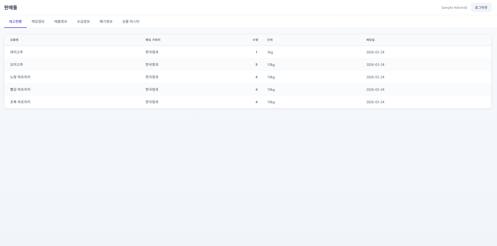
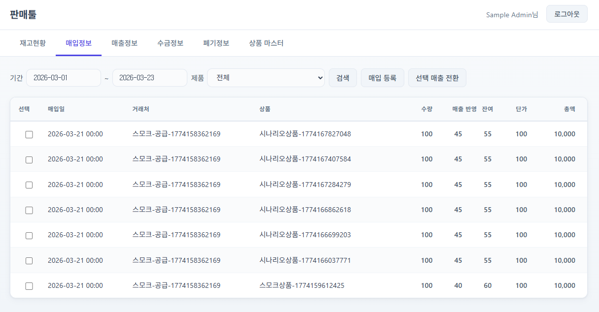
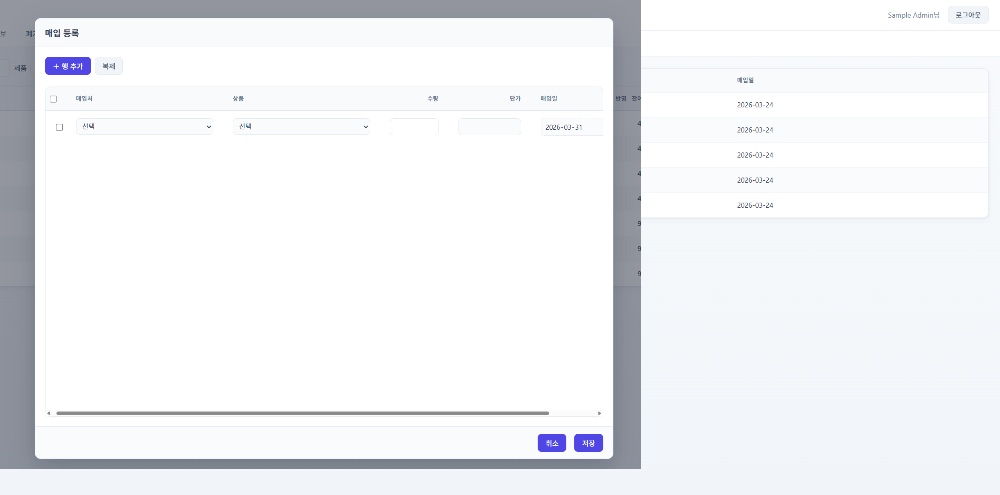
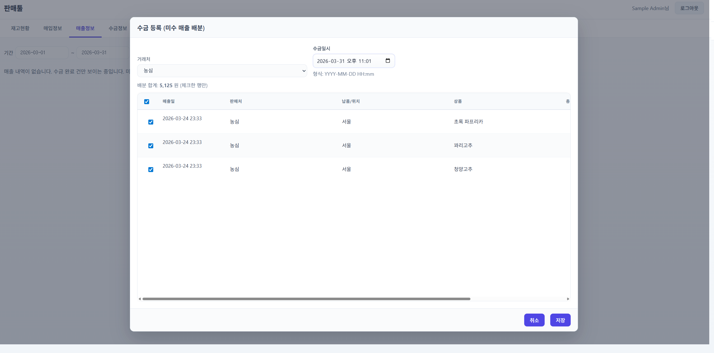
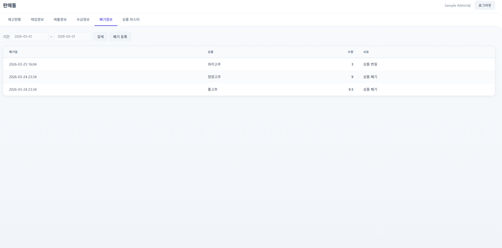
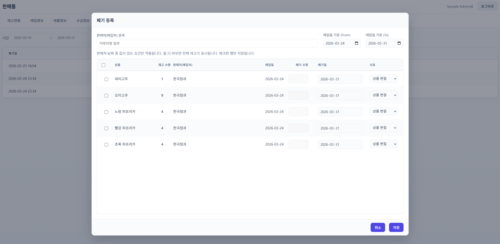
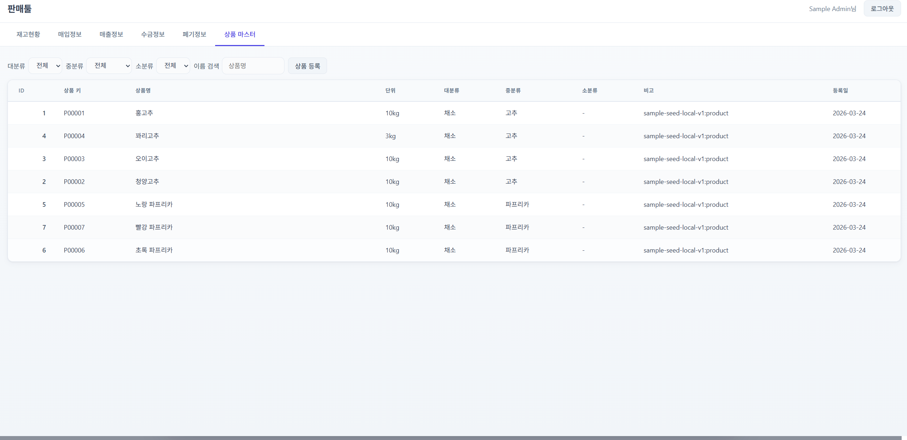

# 판매툴 — 운영자·사용자 매뉴얼

**대상:** 중매인(로그인 사용자). **관리자 전용** 항목은 별도 표기.

> **삽화:** `images/*.svg` 는 자리표시, **`images/*.png` 는 실제 캡처**입니다. PNG를 추가하면 아래 Markdown에서 해당 파일명으로 `` 로 연결하세요. 2026-11-20에 새로 생긴 화면(거래처 탭·거래명세서·경과일·이익 열·CSV 버튼·관리(⋯) 메뉴·정정 모달·원장·미수 연령)은 아직 캡처가 없어 📷 표시만 두었습니다.
>
> **최근 대조:** 2026-11-20 S1 병합본(`d7b8ad8`)의 소스(`web/src/pages/*.jsx`, `web/src/lib/*.js`, `server/index.js`)와 한 줄씩 대조해 문구·열 이름·버튼 순서를 맞췄습니다. 매입·매출 정정(4.4·5.5)과 거래처 원장·미수 연령(9.3·9.4)은 `5f9755a`의 `TradeCorrection.jsx`·`PartnerLedger.jsx`·`TabPartners.jsx`·`Main.jsx`·`server/lib/ledger-routes.js`와 대조했습니다.
>
> **S2 대조(2026-11-20 저녁):** 「오늘」 첫 화면(1.4), 재고에서 바로 판매(2.1), 매입처 지급·지급정보 탭·지급 원장·미지급 연령(4.6, 7장, 9.5·9.6), 개인 품목·공용 등록 요청(4.5, 10.1), 휴대폰에서 쓰는 법(1.5)은 `caa44a3`의 `TabDashboard.jsx`·`FifoSale.jsx`·`SupplierPayments.jsx`·`lib/payablesApi.js`·`ProductRequest.jsx`·`PartnerLedger.jsx`·`TabPartners.jsx`·`TradeCorrection.jsx`·`Main.jsx`·`components/CardMoreToggle.jsx`와 서버 `dashboard-routes.js`·`fifo-routes.js`·`payable-routes.js`·`product-request-routes.js`의 화면 문구·오류 문구를 그대로 옮겼습니다. 이 화면들도 아직 캡처가 없습니다(📷).

---

## 2026-11-20 변경 요약

| 무엇이 바뀌었나 | 어디서 보나 | 한 줄 설명 | 매뉴얼 |
|---|---|---|---|
| 로그인 보안 강화 | 로그인 화면 | 같은 중매인 번호로 **5번 연속 틀리면 15분 동안** 로그인이 막힘. 로그인은 **12시간** 유지 | 1.2 |
| 비밀번호 8자 이상 | 회원가입 화면 | 새 비밀번호는 **8자 이상**(한글은 24자까지). 기존 회원은 바꾸지 않아도 됨 | 1.1 |
| 가입은 이메일 인증만 | 회원가입 화면 | 휴대폰 번호는 받지 않음. 이메일 인증번호로만 본인 확인 | 1.1 |
| **거래처** 탭 새로 생김 | 맨 오른쪽 탭 | 거래처 목록·검색·등록·수정. 매입 등록·매출 전환 중에도 **＋ 새 거래처**로 바로 등록 | 9, 4.2, 4.3 |
| **거래명세서** | 매출정보 → 거래명세서 | 거래처·기간을 고르면 명세서가 나옴. **인쇄 / PDF 저장**, 휴대폰에서는 **공유** | 5.4 |
| 반품 처리 규칙 변경 | 매출정보 → 환불 처리 | 반품 금액은 **미수에서 먼저 빠지고**, 이미 받은 돈이 넘칠 때만 그만큼 **환불금**으로 돌려줌. 외상 매출도 반품 가능 | 5.3 |
| 날짜가 하루 앞당겨 보이던 문제 수정 | 모든 목록 | 매입일·매출일·폐기일·일자가 저장한 날짜 그대로 보임(한국 시간 기준) | 1.3 |
| **엑셀(CSV) 다운로드** | 재고현황·일별·매입·매출·수금·폐기 | 지금 화면 목록을 엑셀에서 열 수 있는 파일로 저장 | 12 |
| 일별 **이익·이익률** | 일별 매입·매출 | 매출 원가·이익·이익률 열 추가. 원가를 모르는 매출은 "원가 미확인"으로 따로 표시 | 3 |
| 재고 **경과일** 배지 | 재고현황 | 오래된 재고를 색으로 표시: **3일 이상 노랑(주의)**, **7일 이상 빨강(경고)** | 2 |
| 매입 **최근 단가 제안**·최근 거래처 | 매입 등록 | 상품을 고르면 지난번 매입 단가를 단가 칸에 미리 채움. 최근 180일 거래한 거래처가 목록 위에 | 4.2 |
| 매입·매출 **정정(수정·취소)** | 매입정보·매출정보 → 행 끝 **관리(⋯)** | 잘못 넣은 매입·매출을 지우지 않고 **수정**하거나 **취소** 상태로 남김. 재고·매입 잔여·미수가 같이 맞춰짐. 매출로 넘어간 매입·수금된 매출 등은 막히고 먼저 할 일을 안내 | 4.4, 5.5 |
| **거래처 원장·미수 연령** | 거래처 → **원장** 버튼 / **미수 연령** 보기 | 판매처별 받을 돈 장부(잔액 = 매출 − 반품 − 수금 + 환불 지급)와, 미수를 매출일부터 **30일 이내 / 31–60일 / 61–90일 / 90일 초과**로 나눠 봄. 거래처 목록에 **미수** 열 추가 | 9.1, 9.3, 9.4 |
| 첫 화면 **「오늘」** | 로그인하면 맨 앞 탭 | 오늘 매입·매출·수금·지급 합계, 받을 돈(총미수)과 4구간, 오래된 재고 상위 5, 미수 많은 거래처 상위 5(누르면 원장) | 1.4 |
| **재고에서 바로 판매**(선입선출) | 재고현황 → 행 끝 **판매** | 판매처·수량·단가만 넣으면 **오래된 매입부터** 자동으로 나감. 저장 전에 어느 매입에서 몇 개 나가는지·원가·이익을 미리 보여 줌. 재고현황에 **판매 가능** 열, 매출정보에 「재고 판매」 배지 | 2, 2.1, 5.1 |
| **매입처 지급**(줄 돈) | 매입정보 → **지급 등록** / **지급정보** 탭 | 매입처에 준 돈을 기록하고 매입별로 나눠 넣음. 매입정보에 **지급·미지급액** 열과 **미지급만** 체크. 잘못 넣은 지급은 **취소**, 예전에 이미 준 매입은 **기초 정리**로 한 번에 정리 | 4.1, 4.6, 7 |
| **지급 원장·미지급 연령** | 거래처 → **지급 원장** 버튼 / **미지급 연령** 보기 | 매입처별 줄 돈 장부(미지급 잔액 = 매입 − 지급)와 매입일부터 센 4구간. 거래처 목록에 **미지급** 열 추가. 지급이 걸린 매입은 취소·매입처 변경이 막힘 | 9.1, 9.5, 9.6, 4.4 |
| **목록에 없는 품목** 바로 추가 | 매입 등록 → **＋ 목록에 없는 품목** | 내 **개인 품목**으로 바로 추가해 그 자리에서 매입. 관리자에게 **공용 품목** 등록을 요청할 수 있고, 관리자는 상품 마스터에서 **승인 / 반려** | 4.5, 10.1 |
| **휴대폰 화면** | 폭이 좁은 화면(휴대폰) | 목록이 카드로 바뀌고 **자세히**로 나머지 값을 펼침. 입력 모달은 행마다 큰 입력 카드, **저장 버튼은 화면 아래에 고정** | 1.5 |

---

## 1. 회원가입·로그인·메인 레이아웃

### 1.1 회원가입

📷 **캡처 권장:** 회원가입 화면 전체(이메일 중복확인/인증번호 입력 포함).

<!--  -->

| 항목 | 설명 |
|------|------|
| **상호명, 이메일, 중매인 번호, 비밀번호** | 필수 입력. 휴대폰 번호는 받지 않습니다(본인 확인은 이메일 인증으로만) |
| **이메일 중복확인** | 형식 검사 후 사용 가능 여부 확인(대소문자 구분 없음). “사용 가능” / “사용 불가” 표시. 이메일을 고치면 중복확인·인증을 다시 해야 함 |
| **인증번호 발송** | 중복확인 통과 후 보임. 이메일로 6자리 인증번호 발송(유효시간 5분, 남은 시간 표시). 다시 누르면 새 번호 발송 |
| **인증하기** | 6자리 코드 검증 후 “이메일 인증 완료” 표시. **5회 틀리면** 그 번호는 무효 — “인증번호를 5회 잘못 입력했습니다. 인증번호를 다시 받아 주세요.” |
| **중매인 번호 중복확인** | 사용 가능 여부 확인. 번호를 고치면 다시 확인해야 함. 짧은 시간에 너무 많이 누르면 “확인 요청이 너무 많습니다. 잠시 후 다시 시도해 주세요.” |
| **비밀번호** | **8자 이상**. 칸 아래에 “8자 이상. 다른 사이트와 다른 비밀번호를 쓰세요.”가 보이고, 짧으면 “8자 이상 입력하세요. (지금 N자)”로 바뀜. 너무 길면(영문·숫자 72자, 한글 24자 초과) “너무 깁니다.” 안내 |
| **개인정보약관 보기 / 동의** | 약관 펼쳐 보기. “개인정보약관에 동의합니다 (필수)” 체크 없으면 가입 불가 |
| **회원가입 버튼 활성 조건** | 네 항목 입력 + 비밀번호 8자 이상 + 이메일 중복확인 + 이메일 인증 완료 + 중매인 번호 중복확인 + 약관 동의 |

**주의:** 이메일 인증 후 **15분 안에** 회원가입 버튼을 눌러야 합니다(지나면 인증을 다시 하라는 안내가 나옴).
**완료 후:** 로그인 화면으로 이동하며 “회원가입이 완료되었습니다. 로그인해 주세요.” 안내가 표시됩니다.
**기존 회원:** 예전에 8자보다 짧게 만든 비밀번호도 그대로 로그인됩니다.

### 1.2 로그인

| 항목 | 설명 |
|------|------|
| **중매인 번호, 비밀번호** | 둘 다 입력 후 **로그인**. 틀리면 “중매인 번호 또는 비밀번호가 올바르지 않습니다.” |
| **연속 실패 제한** | 같은 중매인 번호로 **5번 연속** 틀리면 **15분 동안** 로그인이 막힘 — “로그인 시도가 너무 많습니다. N분 뒤에 다시 시도해 주세요.” 시간이 지나거나 로그인에 성공하면 다시 셈 |
| 비활성 계정 | 비밀번호가 맞을 때 “비활성화된 계정입니다.” 안내 후 로그인 불가 |
| **회원가입** 링크 | 회원가입 화면으로 이동 |

**로그인 유지:** 로그인하면 **12시간** 동안 유지됩니다. 시간이 지나거나 로그인 정보가 맞지 않으면 다음 화면 이동 때 **로그인 화면으로 돌아갑니다** — 다시 로그인하면 됩니다.
로그인 정보는 **브라우저 탭**에만 저장됩니다. 탭·브라우저를 닫으면 다시 로그인해야 합니다.

### 1.3 메인 레이아웃

📷 **캡처:** 로그인 후 첫 화면 전체(탭·본문이 보이게). *(거래처 탭이 추가된 화면으로 다시 캡처 필요)*

| 영역 | 설명 |
|------|------|
| 헤더 | 서비스명(판매툴), **상호명 + “님”**, 우측 **로그아웃** — 로그인 정보를 지우고 로그인 화면으로 이동 |
| 탭 | **오늘 · 재고현황 · 일별 매입·매출 · 매입정보 · 매출정보 · 수금정보 · 지급정보 · 폐기정보 · 거래처** (첫 화면은 **오늘**, 1.4) |
| 본문 | 선택한 탭의 필터·버튼·테이블·모달 |

**관리자:** 맨 끝에 `상품 마스터` 탭이 추가로 보입니다.

**목록 공통:**
- 기간 필터의 기본값은 **이번 달 1일 ~ 오늘**이며, 탭을 처음 열 때 한 번 조회하고 그다음은 **검색** 버튼을 눌러야 갱신됩니다.
- 긴 글자는 칸 위에 마우스를 올리면 전체가 보입니다.
- 날짜는 **한국 시간 기준, 저장한 날짜 그대로** 보입니다(2026-11-20 수정 — 예전에는 서버 설정에 따라 하루 앞 날짜로 보일 수 있었음). 매입일·매출일·폐기일 옆의 시:분은 **등록한 시각**입니다.
- 재고현황·일별·매입·매출·수금·지급·폐기 탭에는 **엑셀(CSV) 다운로드** 버튼이 있습니다(12장).

### 1.4 「오늘」 탭 (첫 화면)

📷 **캡처 필요:** 오늘 화면 전체(데스크톱), 휴대폰 화면, 거래가 없는 날 화면.

로그인하면 맨 앞 **오늘** 탭이 열립니다. 출근해서 오늘 들어오고 나간 돈, 받을 돈, 오래된 재고를 한 화면에서 봅니다. 위에 “YYYY년 M월 D일 (요일) 기준”이 보이고, 오늘 등록한 거래가 하나도 없으면 옆에 “· 오늘 등록한 거래가 아직 없습니다”가 붙습니다.

| 영역 | 보이는 것 | 누르면 |
|---|---|---|
| **새로고침** | 숫자를 다시 불러옴(불러오는 동안 “불러오는 중…”) | — |
| **오늘 매입** | 오늘 매입일인 매입 합계(원)와 건수. 없으면 “오늘 매입 없음” | **매입정보 ›** → 매입정보 탭 |
| **오늘 매출** | 오늘 매출일인 매출 합계와 건수(반품을 빼지 않은 총액 — 일별 매입·매출 탭과 같음) | **매출정보 ›** → 매출정보 탭 |
| **오늘 수금** | 오늘(한국 날짜) 받은 돈 합계와 건수. 반품 때 돌려준 환불금은 넣지 않음 | **수금정보 ›** → 수금정보 탭 |
| **오늘 지급** | 오늘 매입처에 준 돈 합계와 건수. **기초 정리**와 취소한 지급은 넣지 않음(7장) | **지급정보 ›** → 지급정보 탭 |
| **받을 돈(총미수)** | 총미수 금액, “거래처 N곳 · 매출 N건”, 구간 막대와 **30일 이내 · 31–60일 · 61–90일 · 90일 초과** 금액(90일 초과는 빨강). 아래 “경과일 = 오늘 − 매출일”. 없으면 “받을 돈이 없습니다.” | **거래처별 미수 연령 ›** → 거래처 탭(미수 연령은 9.4) |
| **오래된 재고** | 위에 “7일 이상 N건”(빨강)·“3일 이상 N건”(노랑) 배지, 아래 경과일이 긴 상품 **5개**: 상품명, “수량 단위 · 날짜 매입분부터”, “N일” 배지. 3일 넘은 재고가 없으면 “3일 넘은 재고가 없습니다.”, 재고가 아예 없으면 “남은 재고가 없습니다.” | **재고현황 ›** → 재고현황 탭 |
| **미수 많은 거래처** | 미수가 큰 거래처 **5곳**: 거래처명, “매출 N건 · 가장 오래된 매출 N일 전”(90일 넘은 미수가 있으면 “· 90일 초과 금액” 빨강), 미수 금액, **원장 ›**. 없으면 “미수가 있는 거래처가 없습니다.” | 줄을 누르면 그 거래처 **원장** 창(9.3)이 바로 열림. 오른쪽 **거래처 ›** → 거래처 탭 |

- 숫자 기준은 다른 화면과 같습니다: 취소한 매입·매출은 빠지고, 미수·구간은 미수 연령(9.4)과, 경과일은 재고현황(2장)과 같은 계산입니다.
- 원장 창에서 **미수 연령 보기**를 누르면 거래처 탭으로 넘어갑니다.
- 불러오기에 실패하면 오류 문구와 **다시 불러오기** 버튼이 보입니다.

### 1.5 휴대폰에서 쓰는 법

📷 **캡처 필요:** 휴대폰 폭(약 390px)의 매입정보 카드 목록(자세히 펼침 전·후), 매입 등록 모달.

화면 폭이 좁으면(휴대폰) 같은 화면이 아래처럼 바뀝니다. 기능과 버튼 이름은 같습니다.

| 화면 | 휴대폰에서 |
|---|---|
| 탭 | 탭 줄을 **옆으로 밀어** 다른 탭으로 이동 |
| 버튼 줄 | 주 버튼(매입 등록·수금 등록·거래처 등록 등)은 맨 위 한 줄 전체, 나머지(검색·엑셀(CSV) 다운로드 등)는 두 칸씩. 기간은 한 줄(시작 ~ 끝) |
| 목록(재고현황·일별·매입·매출·수금·지급·폐기·거래처·상품 마스터) | 표 대신 **카드** 한 장이 한 줄. 카드에는 제목(상품·거래처)·날짜·핵심 값 3~4개가 보이고, 나머지(출처·단가·주소·메모 등)는 카드 아래 **자세히**를 누르면 펼쳐짐(**접기**로 다시 닫음). 매입·매출 카드의 **⋯**(관리) 메뉴와 체크 칸도 카드 안에 있음 |
| 재고현황 카드 | 경과 3일·7일 넘은 카드는 왼쪽에 노랑·빨강 줄. **판매** 버튼도 카드 안에 있음(2.1) |
| 입력 모달(매입 등록·매출 전환·수금 등록·환불 처리·폐기 등록·상품 등록) | 표 한 줄이 **입력 카드 하나**로 바뀜: 칸이 크고(손가락으로 누르기 쉽게), 수량·단가·금액 칸은 **숫자 키패드**가 뜸. 체크한 카드는 테두리가 강조됨 |
| 저장 버튼 | 모달의 **저장 · 취소** 버튼은 **화면 맨 아래에 고정** — 입력 카드가 길어 스크롤해도 늘 보임 |
| 수정·취소 모달, 원장 창 | 화면 전체를 덮는 시트로 열림 |
| 「오늘」 | 오늘 매입·매출·수금·지급이 카드 한 장 안의 줄로 묶이고, 받을 돈 4구간은 위아래 줄(구간 왼쪽·금액 오른쪽)로 보임 |
| 미수 연령·미지급 연령 표 | 카드 대신 **옆으로 밀어** 봄. 거래처 이름 칸은 고정됨 |

**팁:** 경매장·창고에서는 매입 등록 → 카드에 값 입력 → 아래 고정된 **저장** 순서로 한 손 입력이 됩니다. 넓은 화면(태블릿 가로·PC)에서는 예전처럼 표로 보입니다.

---

## 2. 재고현황 탭

📷 **캡처:** 재고현황 테이블이 보이는 화면. *(경과일 열·배지가 보이게 다시 캡처 필요)*

| 요소 | 역할 |
|------|------|
| (필터 없음) | 전체 재고 목록을 불러옴. **수량이 0인 상품은 표시하지 않음** |
| **엑셀(CSV) 다운로드** | 지금 보이는 재고 목록을 파일로 저장(12장) |
| 경과일 요약 | 표 위에 **7일 이상 N건**(빨강) · **3일 이상 N건**(노랑) |
| 테이블 열 | **상품명**, **출처**, **매입 거래처**, **수량**, **판매 가능**, **단위**, **최근 매입일**, **경과일**, **판매**. 출처·매입 거래처·최근 매입일은 그 상품의 **가장 최근 매입** 기준 |
| **경과일** | “N일” 배지. **3일 이상 노랑(주의)**, **7일 이상 빨강(경고)** — 행 왼쪽에도 같은 색 줄이 표시됨 |
| **판매 가능** | 지금 바로 팔 수 있는 수량(2.1). 보통 수량과 같고, 다르면 숫자 아래에 이유가 붙음: **미연결 N**(반품으로 돌아온 N은 어느 매입에서 왔는지 연결이 없어 자동 판매에서 빠짐) 또는 **날짜 제한**(오늘 이후 날짜로 등록한 매입은 오늘 판매에 쓰지 않음). 마우스를 올리면 설명이 보임 |
| **판매** | 그 상품의 **판매** 창을 엶(2.1). 판매 가능이 0이면 눌리지 않고, 마우스를 올리면 이유(“판매할 수 있는 재고가 없습니다.” 등)가 보임 |

**경과일 계산:** 오늘 − **남은 재고 중 가장 오래된 매입일**. 먼저 들어온 물건부터 나간다고 보고 계산합니다. 그래서 새 물건이 들어와도 오래 남은 물건이 있으면 경과일이 줄지 않습니다. 배지에 마우스를 올리면 기준 매입일이 보입니다.

**역할:** 상품별 재고 수량과 **오래 묵은 재고**를 확인합니다. 빨강 행부터 매출 전환이나 폐기를 검토하세요. 매입·매출 전환·반품(재고로 돌아옴)·폐기 후 갱신된 값이 표시됩니다.

### 2.1 재고에서 바로 판매 (선입선출)

📷 **캡처 필요:** 판매 창(미리보기 로트 2개 이상), 최대치를 넘었을 때(빨간 안내 + 채우기 버튼), 원가보다 낮은 단가 경고, 저장 뒤 결과 화면.

매입정보의 **선택 매출 전환**(4.3)은 어느 매입에서 팔지 직접 고릅니다. 재고현황의 **판매**는 상품·수량만 정하면 **오래된 매입부터 자동으로** 나눠 뺍니다(먼저 들어온 물건 먼저 — 선입선출). 경과일이 긴 물건부터 자연히 줄어듭니다.

**여는 법:** 재고현황에서 그 상품 행 끝의 **판매** 버튼. 창 제목은 “상품명 판매”, 그 아래 “재고 N · 판매 가능 N 단위”.

| 칸·요소 | 설명 |
|---|---|
| **판매처** | 필수. 판매에 쓸 수 있는 거래처(판매처·같은 시장·도매상·시장도매인)만 보임 |
| **판매일** | 기본 오늘 |
| **수량 (단위)** | 필수. 0보다 크게, 소수 가능 |
| **단가(원)** | 필수. 0 이상 |
| **메모** | 선택(예: 오전 주문) |
| 미리보기 “오래된 매입부터 나갑니다” | 수량을 넣으면 잠시 뒤 **어느 매입에서 몇 개 나가는지** 줄마다 보임: “월/일 매입처(출처)  수량 × 매입 단가 = 원가”. 오른쪽 위에 “매출액 N원”, 아래 “원가 N · 이익 N (이익률%)”(이익이 마이너스면 빨강). 수량을 넣기 전에는 “수량을 넣으면 어느 매입에서 나가는지 보여 줍니다.”, 계산 중에는 “계산 중…” |
| 수량이 판매 가능보다 많을 때 | 빨간 안내 “최대 N까지 팔 수 있습니다.” + **N(으)로 채우기** 버튼(누르면 수량 칸이 최대치로 바뀜). 이때는 **판매 저장**이 눌리지 않음. 반품분이 섞여 있으면 “반품으로 들어온 N은(는) 매입과 연결이 없어 자동 판매에서 빠집니다.”가 함께 보임 |
| 단가가 원가보다 낮을 때 | 노란 안내 “원가(평균 원가)보다 낮은 단가입니다. 저장은 할 수 있습니다.” — 경고일 뿐, 저장은 됨 |
| 쓸 매입이 없을 때 | “이 판매일에 쓸 수 있는 매입이 없습니다.” (판매일보다 뒤 날짜의 매입은 쓰지 않음) |
| **취소** / **판매 저장** | 판매처·수량·단가가 있고 미리보기상 재고가 충분할 때만 저장됨(저장 중 “저장 중…”) |

**저장하면:** 매출 **1건**이 생기고, 미리보기에 나온 매입들에서 수량이 빠집니다(재고 감소, 각 매입의 매출 반영·잔여도 같이 바뀜). 창에 “상품 수량 단위 판매를 저장했습니다 (매출 #번호)”, “매출 N원 · 원가 N원 · 이익 N원 (%)”, “거래명세서는 매출정보 탭 또는 거래처 탭에서 볼 수 있습니다.”가 보이고, 재고현황 위에도 “상품 수량 판매 저장(매출 #번호)” 알림이 뜹니다. 같은 상품을 더 팔려면 **이어서 판매**(판매처·판매일·단가는 그대로, 수량·메모만 비워짐), 끝내려면 **닫기**.

**동시에 팔렸을 때:** 다른 화면에서 같은 재고를 먼저 팔아 모자라게 되면 저장되지 않고 “상품명 재고가 부족합니다. 지금 팔 수 있는 수량은 N입니다.”가 보이며 미리보기가 새로 계산됩니다. 일부만 저장되는 일은 없습니다.

**이렇게 만든 매출은:** 매출정보 목록에서 상품 옆에 **「재고 판매」** 배지가 붙습니다(배지에 마우스를 올리면 “재고에서 오래된 매입부터 나간 판매”, 매입 2건 이상에서 나갔으면 “(매입 N건에서)”가 붙음). 매입과 연결돼 있으므로 일별 탭의 원가·이익(3장), 수금·반품·거래명세서·원장은 다른 매출과 똑같이 됩니다.

**재고 판매 매출을 고칠 때(5.5):** 수량을 줄이면 **가장 최근 매입 몫부터** 줄이고, 늘리면 다시 오래된 매입부터 더 가져옵니다. 늘릴 재고가 모자라면 “재고가 부족합니다. 최대 N까지 바꿀 수 있습니다.” 판매일은 이 매출이 가져간 매입 중 가장 늦은 매입일보다 앞으로 바꿀 수 없습니다 — “판매일은 이 매출에 배분된 매입의 가장 늦은 매입일(날짜) 이후여야 합니다.”

---

## 3. 일별 매입·매출 탭

📷 **캡처:** 일자 요약 + 상품·거래처별 내역(이익 열이 보이게).

| 요소 | 역할 |
|------|------|
| **일자** | 조회할 하루(기본: 오늘) |
| **거래처 필터** | **전체 거래처**(기본)면 모두. 고르면 매입은 그 구입처, 매출은 그 판매처 기준 |
| **검색** | 조건으로 다시 집계 |
| **엑셀(CSV) 다운로드** | 지금 화면의 **상품·거래처별 내역**(마지막 검색 결과)을 저장(12장) |
| **일자 요약** 표 | 일자 · 매입액 · 매입 건수 · 매출액 · 매출 건수 · **매출 원가** · **이익** · **이익률** · **차이(매출−매입)** |
| **상품·거래처별 내역** 표 | 상품 · 거래처 · **구분(매입/매출)** · 건수 · 수량 · 금액 · **미수** · **원가** · **이익(률)**. 맨 아래 합계(매입 / 매출) |

**이익 계산:**
- **원가** = 그 매출에 연결된 매입의 단가 × 수량 (매입정보에서 **선택 매출 전환**으로 만든 매출이면 자동으로 연결됨)
- **이익** = 매출액 − 원가, **이익률** = 이익 ÷ 매출액
- 이익이 마이너스면 **빨간색**으로 보입니다.
- 매입과 연결되지 않은 매출(예전 자료 등)은 원가를 알 수 없어 **원가 미확인 N건**으로 따로 표시하고 이익·이익률 계산에서 뺍니다.
- 반품(환불)한 금액은 이익에서 빼지 않습니다.

**미수:** 매출 행의 남은 받을 돈(매출액 − 반품액 − 수금액)입니다. 취소된 매출은 집계에서 빠집니다.

---

## 4. 매입정보 탭

📷 **캡처:** 매입정보 필터 + 목록 + 상단 버튼 영역.

### 4.1 필터·버튼·목록

| 요소 | 역할 |
|------|------|
| **기간** (시작~끝) | `YYYY-MM-DD` 형식. 해당 기간의 매입만 조회 |
| **제품** | 드롭다운 — 특정 상품만 보거나 **전체** |
| **검색** | 위 조건으로 목록 다시 불러오기 |
| **매입 등록** | 매입 입력 모달을 엽니다 |
| **선택 매출 전환** | 목록에서 체크한 매입 행을 **판매(매출)** 로 전환하는 모달을 엽니다. 남은 수량이 있는 행만 전환됨 |
| **미지급만** | 체크하고 **검색**하면 **기간과 상관없이** 아직 다 주지 않은 매입(미지급·일부, 취소 제외)만 보임 |
| **지급 등록** | 매입처에 준 돈을 기록하는 모달(4.6). 목록에서 매입을 체크해 두면 **그 매입처의 체크한 매입만** 채운 상태로 열림. 서로 다른 매입처를 체크했으면 “지급 등록은 매입처 한 곳씩 합니다 — 첫 번째 매입처의 매입만 채웠습니다.” |
| **엑셀(CSV) 다운로드** | 지금 보이는 매입 목록을 저장(12장) |
| 목록 열 | 선택 · 매입일(일시) · 출처 · 매입 거래처 · 상품 · 수량 · **매출 반영** · **잔여** · 단가 · 총액 · **지급** · **미지급액** · **관리**(⋯ 메뉴, 4.4). 잔여가 0인 행은 체크할 수 없음 |
| **지급** | 그 매입에 돈을 얼마나 줬는지: **미지급**(아직 안 줌) / **일부** / **완료**. 취소된 매입은 “—” |
| **미지급액** | 매입 총액 − 그 매입에 나눠 넣은 지급 합계 |
| 취소된 매입 | 행이 회색으로 보이고 매입일 옆에 「취소」 배지가 붙음. 배지에 마우스를 올리면 “취소 사유: …”. 체크할 수 없고 ⋯ 메뉴도 눌리지 않음 |

### 4.2 매입 등록 모달

📷 **캡처:** 매입 등록 모달 전체. *(＋ 새 거래처 버튼·최근 단가 안내가 보이게 다시 캡처 필요)*

| 요소 | 역할 |
|------|------|
| **＋ 행 추가** | 입력 행을 한 줄 늘림 |
| **복제** | 체크한 행 내용을 복사해 새 행 추가 |
| **＋ 새 거래처** | 거래처 등록 창을 엶(9.2와 같은 칸). 등록하면 목록에 바로 추가되고 **거래처가 비어 있는 행에 자동 선택**됨. 유형은 매입에 쓸 수 있는 것만 보임 |
| **＋ 목록에 없는 품목** | 상품 목록에 없는 품목을 내 **개인 품목**으로 바로 추가(4.5). 추가하면 **상품이 비어 있는 첫 행**에 자동 선택됨. 각 행의 상품 목록 맨 끝 **＋ 목록에 없는 품목 추가…** 를 골라도 같은 창이 열리고, 그 행에 선택됨 |
| **체크박스** | 행 선택(복제에 사용). 머리글 체크박스는 전체 선택 |
| **출처** | 선택 입력(예: 한국청과) |
| **매입 거래처** | 필수. 매입 가능한 거래처만 나옴. **최근 거래**(최근 180일 동안 매입한 거래처, 최근 순)가 위에, **그 외 (가나다순)** 이 아래에 묶여 보임. 이름 옆 괄호는 거래처 유형 |
| **상품·수량·단가·매입일** | 필수. 단가는 천 단위 콤마로 표시. 상품 목록에는 공용 품목과 **내 개인 품목**이 함께 보이고, 개인 품목은 이름 뒤에 “(개인)”, “(개인·공용 요청 중)”, “(개인·요청 반려)”가 붙음 |
| **단가 제안** | 상품을 고르면 **최근 매입 단가**가 단가 칸에 미리 채워지고, 칸 아래에 “최근: 날짜 · 금액원”이 보임. 고른 거래처의 기록이 있으면 그 거래처 기준, 없으면 다른 거래처 기록으로 채우고 “(다른 거래처: 이름)”을 붙임. 기록이 없으면 “최근 매입 없음” |
| 단가 직접 입력 | 제안값은 **바꾸면 입력한 값**이 저장됩니다. 직접 입력한 뒤 상품·거래처를 바꿔도 그 값은 덮어쓰지 않음 |
| **×** | 그 행 삭제(행이 하나뿐이면 삭제 불가) |
| **취소** | 모달 닫기(저장 안 함). 다시 열면 입력표가 **빈 1행**으로 초기화됨 |
| **저장** | 다 채운 행만 서버에 순서대로 등록(빈 행은 무시, 일부만 채운 행이 있으면 “입력이 완료되지 않은 행이 있습니다. 비우거나 모두 채워 주세요.” 안내 후 저장 안 함) |

**저장 중 오류:** 오류 메시지는 모달 안에 표시됩니다. 여러 행 중 일부가 이미 저장된 뒤 실패하면, **저장된 행은 입력표에서 빠지고** 남은 행만 남습니다(다시 저장해도 중복 등록되지 않음).

### 4.3 선택 매출 전환 모달

📷 **캡처:** 매출 전환 모달.

| 요소 | 역할 |
|------|------|
| **판매처** | 매출에 찍힐 거래처(판매 가능한 거래처만) |
| **＋ 새 거래처** | 판매처 옆 버튼. 등록하면 **판매처로 자동 선택**됨. 유형은 판매에 쓸 수 있는 것만 보임 |
| **판매일** | 판매 일자(기본: 오늘) |
| 표 | 매입 ID · 상품 · **남은 수량** · **전환 수량** · **판매 단가** |
| **전환 수량·판매 단가** | 기본값은 남은 수량·매입 단가. 매입 잔량 이내로 매출 생성 |
| **저장** | 선택 매입 → 매출 전환 처리(모든 행을 한 번에 처리 — 한 행이라도 실패하면 전부 취소). 오류는 모달 안에 표시 |

**참고:** 이렇게 전환한 매출은 매입과 연결되므로 일별 탭에서 원가·이익이 계산됩니다(3장).

### 4.4 매입 수정·취소 (관리 ⋯ 메뉴)

📷 **캡처 필요:** 관리(⋯) 메뉴가 열린 매입 행, 매입 수정 모달, 매입 취소 모달, 연결된 매출 안내.

잘못 넣은 매입은 지우지 않고 **수정**하거나 **취소** 상태로 남깁니다. 목록 행 맨 끝 **관리** 열의 **⋯** 버튼을 누르면 **수정** / **취소** 메뉴가 열립니다(Esc·바깥 클릭·스크롤 시 닫힘).

**메뉴가 막히는 경우** — 막힌 메뉴는 회색이고, 메뉴 아래에 이유가 보입니다.

| 상황 | 수정 | 취소 | 화면 안내 |
|---|---|---|---|
| 매출로 넘어가지 않은 매입 | 모든 칸 | 가능 | — |
| 일부·전부 매출로 전환된 매입 | 가능(아래 제한) | **막힘** | “매출로 전환된 수량이 있어 취소할 수 없습니다. 연결된 매출을 먼저 취소하세요.” |
| 지급 기록이 있는 매입(지급 일부·완료) | 가능 — **매입처는 못 바꾸고**, 금액(수량×단가)은 이미 준 돈 이상으로만 | **막힘** | “지급 기록이 있어 취소할 수 없습니다 — 지급정보에서 지급을 먼저 취소하세요.” |
| 이미 취소된 매입 | 막힘 | 막힘 | “취소된 매입입니다.” |

**매입 수정 모달** (제목 “매입 #번호 수정”)

| 칸 | 설명 |
|---|---|
| 상품 · 매입 거래처 · 수량 · 단가 · 매입일 · 출처 · 메모 | 지금 값이 채워져 있음. 고친 칸만 저장됨 |
| **수정 사유 (필수)** | 예: 수량 오타. 비우면 “수정 사유를 입력하세요.” |
| 아래 안내 | 아무것도 안 고쳤으면 “바꿀 값을 고치면 저장할 수 있습니다.”(**저장** 버튼 비활성). 고쳤으면 “바뀐 칸 N개만 저장합니다. 총액은 수량×단가로 다시 계산됩니다.” |
| 매출로 전환된 매입 | 위에 “매출 반영 N — 수량은 N 이상으로만 바꿀 수 있고, 상품은 바꿀 수 없습니다.” 상품 칸이 잠김. 더 적게 넣으면 “매출로 전환된 수량(N)보다 적게 바꿀 수 없습니다.” |
| 지급 기록이 있는 매입 | 위에 “지급 N — 매입처는 바꿀 수 없고, 금액(수량×단가)은 N 이상으로만 바꿀 수 있습니다.” 매입처 칸이 잠김(마우스를 올리면 “지급 기록이 있는 매입은 매입처를 바꿀 수 없습니다.”) |
| **닫기** / **저장** | 저장 중에는 “처리 중…”. 성공하면 위에 “매입 #번호를 수정했습니다.”가 몇 초 보이고 목록이 새로 고쳐짐 |

**매입 취소 모달** (제목 “매입 취소”)

- 맨 위: “**매입 #번호** · 상품 수량단위 · 매입일 을(를) 취소합니다.”
- 재고 변화: “재고 상품 **지금 수량 → 취소 후 수량**”(모자라면 빨간 숫자).
- 안내: “지우지 않고 「취소」 상태로 남깁니다. 재고에서 빠지고 매입처로 되돌린 이동 이력이 남습니다.” / “취소한 거래는 되살릴 수 없습니다. 필요하면 새로 등록하세요.”
- **취소 사유**: 오입력 · 중복 입력 · 거래 취소 · 기타 중 하나(기본 “오입력”). **기타**를 고르면 사유를 직접 입력(비우면 “취소 사유를 입력하세요.”).
- **닫기** / **취소 실행**(빨간 버튼). 성공하면 “매입 #번호를 취소했습니다.” 행은 회색 + 「취소」 배지로 남습니다.

**저장·취소를 눌렀는데 서버가 막을 때** — 모달 안 빨간 영역에 이유와 먼저 할 일이 나옵니다. 화면이 메뉴를 미리 막아도, 다른 화면에서 먼저 바뀐 경우를 위해 서버가 한 번 더 판정합니다.

| 경우 | 화면에 보이는 것 | 먼저 할 일 |
|---|---|---|
| 연결된 매출이 있음 | “연결된 매출 N건을 먼저 취소하세요.”(수정에서 상품을 바꾸려 했으면 “… 상품을 바꿀 수 없습니다. 매출을 먼저 취소하세요.”) + 표 “연결된 매출 — 매출정보에서 먼저 취소하세요”(매출 · 매출일 · 판매처 · 수량 · 수금) + **매출정보에서 보기** 버튼 | 버튼을 누르면 매출정보 탭이 그 매출 날짜 구간·**미수·일부 포함** 체크 상태로 열림 → 그 매출을 먼저 취소(5.5) |
| 재고가 모자람(이미 폐기·판매됨) | “현재 재고 N(으)로 M을(를) 되돌릴 수 없습니다. 폐기·매출 내역을 확인하세요.” + “현재 재고 N — 폐기정보·매출정보를 확인하세요.” | 폐기·매출 기록 확인. **폐기 취소 기능은 아직 없음** |
| 지급이 걸려 있음 | 취소: “지급 N건이 있어 취소할 수 없습니다. 지급정보에서 지급을 먼저 취소하세요.” / 매입처 변경: “지급 N건이 있어 매입처를 바꿀 수 없습니다. …” + 표 “걸린 지급 — 지급정보에서 먼저 취소하세요”(지급 · 지급일 · 이 매입 몫, 기초 정리면 “(기초 정리)”) | 지급정보 탭에서 그 지급을 **취소**(7장) → 다시 매입 정정 |
| 금액을 이미 준 돈보다 적게 바꿈 | “이미 지급한 금액(N)보다 매입 금액을 적게 바꿀 수 없습니다.” + “이미 지급 N — 매입 금액은 이 금액 이상이어야 합니다. 줄이려면 지급을 먼저 취소하세요.” | 지급을 먼저 취소한 뒤 수정하고, 맞는 금액으로 다시 지급 등록 |
| 이미 취소됨 | “이미 취소된 매입입니다.” | 목록이 다시 불러와짐 |
| 다른 곳에서 먼저 바뀜 | “다른 곳에서 먼저 바뀌었습니다. 최신 내용으로 다시 불러온 뒤 시도하세요.” + “목록을 최신 내용으로 다시 불러왔습니다. 값을 확인한 뒤 다시 저장하세요.” | 모달을 닫고 다시 열어 새 값으로 고친 뒤 저장 |

### 4.5 목록에 없는 품목 — 개인 품목과 공용 등록 요청

📷 **캡처 필요:** “목록에 없는 품목 추가” 창, 같은 이름 공용 품목이 있을 때 안내, 상품 목록의 “(개인·공용 요청 중)” 표시.

공용 상품(상품 마스터)은 관리자만 등록합니다. 경매에 새 품목이 나왔는데 목록에 없으면, 매입을 멈추지 말고 **내 개인 품목**으로 바로 추가해 씁니다.

**여는 법:** 매입 등록 모달의 **＋ 목록에 없는 품목** 버튼, 또는 행의 상품 목록 맨 끝 **＋ 목록에 없는 품목 추가…**.

창 제목 “목록에 없는 품목 추가”, 안내 “내 **개인 품목**으로 바로 추가되어 지금 매입에 쓸 수 있습니다. 다른 중매인에게는 보이지 않습니다.”

| 칸 | 설명 |
|---|---|
| **품목명 \*** | 필수(예: 샤인머스캣 2kg). 비우면 “품목명을 입력하세요.” |
| **단위** | 기본 `kg` |
| **대분류** | 선택(예: 과일) |
| **관리자에게 공용 품목으로 등록을 요청합니다** | 기본 체크. “(승인되면 모든 중매인이 씁니다. 지금까지의 매입은 그대로 이어집니다)” |
| **요청 메모** | 위 체크가 켜져 있을 때만 보임(예: 이번 주부터 경매에 자주 나옴) |
| **취소** / **추가** | 추가하면 그 행의 상품으로 바로 선택되고, 최근 단가 제안도 그대로 동작 |

**이름이 겹칠 때** (앞뒤 공백·연속 공백·대소문자는 무시하고 비교)

| 경우 | 화면 안내 | 할 일 |
|---|---|---|
| 같은 이름의 **공용 품목**이 이미 있음 | “같은 이름의 공용 품목 「이름」이 이미 있습니다. 그 품목을 선택하세요.” + **「이름」 선택** 버튼 | 버튼을 누르면 그 공용 품목이 행에 선택됨 |
| 내 개인 품목에 같은 이름이 있음 | “내 개인 품목에 「이름」이 이미 있습니다.” + **「이름」 선택** 버튼 | 버튼으로 기존 개인 품목 선택 |
| 다른 중매인이 같은 이름의 개인 품목을 가짐 | 안내 없음 — 서로 보이지 않으므로 각자 만들 수 있음 | — |

**개인 품목은:** 나만 보고 나만 씁니다. 매입 등록·매입 수정에서 고를 수 있고, 그 매입에서 이어지는 재고·매출 전환·재고 판매·폐기·거래명세서도 다른 품목과 똑같이 됩니다. 상품 목록에서는 이름 뒤 상태로 구분합니다.

| 표시 | 뜻 |
|---|---|
| 이름 (개인) | 내 개인 품목, 공용 요청 안 함 |
| 이름 (개인·공용 요청 중) | 관리자 승인 대기 |
| 이름 (개인·요청 반려) | 관리자가 반려 — 계속 개인 품목으로 쓸 수 있음 |
| 이름만 | 공용 품목(승인되면 괄호가 사라짐) |

**승인되면** 같은 품목이 그대로 공용으로 바뀌므로, 그동안의 매입·재고·매출은 옮기지 않아도 이어집니다. 관리자 쪽 처리는 10.1.

### 4.6 매입처 지급 등록 (줄 돈)

📷 **캡처 필요:** 지급 등록 모달(매입처 선택 후 배분 표), 배분 합이 맞지 않을 때 안내.

매입처에 대금을 주면 **지급 등록**으로 기록합니다. 한 번 준 돈을 여러 매입에 나눠 넣고(배분), 매입마다 **지급** 상태(미지급·일부·완료)와 **미지급액**이 바뀝니다. 받을 돈(미수)의 반대편인 **줄 돈(미지급)** 장부입니다.

**여는 법:** 매입정보 탭 **지급 등록**(체크한 매입이 있으면 그 매입만 채워서 열림, 4.1) 또는 지급정보 탭 **지급 등록**(7장).

| 칸·요소 | 설명 |
|---|---|
| **매입처** | 필수. 매입에 쓰는 거래처(매입처·같은 시장·도매상·시장도매인)만, 가나다순. 줄 돈이 있으면 이름 뒤에 “(미지급 금액)” |
| **지급액** | 이번에 준 돈. 넣으면 아래 표에 **오래된 매입부터** 자동으로 채워짐 |
| **지급일시** | 기본 지금 |
| **방법** | 계좌이체(기본) / 현금 / 어음 / 기타 |
| **메모** | 선택(예: 10월분) |
| 배분 표 | 위에 “매입처 미지급 매입 N건 · 합계 N원 · 오래된 매입부터 채움”(체크한 매입으로 열었으면 “· 선택한 매입만 채웠습니다”). 열: 매입일(#번호) · 상품 · 총액 · **남은 미지급** · **이번 지급**(직접 고칠 수 있음). 맨 아래 “배분 합 / 지급액” |
| 아래 안내 | 상황에 따라: “매입처를 고르세요.” / “이 매입처에 지급할 매입이 없습니다.” / “지급액을 넣으면 오래된 매입부터 채웁니다.” / “지급액이 미지급 합계(N원)보다 많습니다. 선급금은 아직 기록할 수 없습니다.” / “매입 #번호에 남은 미지급보다 많이 넣었습니다.” / “배분 합 N원 / 지급액 N원 — 같아야 저장할 수 있습니다.” 문제가 없으면 “저장하면 매입별 지급 상태(미지급·일부·완료)가 바뀝니다. 잘못 넣었으면 지급정보에서 취소할 수 있습니다.” |
| **취소** / **지급 저장** | 배분 합 = 지급액이고, 어느 매입도 남은 미지급을 넘지 않을 때만 저장됨 |

**저장하면:** “매입처에 N원을 지급했습니다 — 미지급 N원 남음.” 알림이 뜨고 목록의 지급·미지급액, 거래처 탭의 **미지급** 열, 「오늘」의 **오늘 지급**이 바뀝니다.

**알아 둘 것**
- 매출로 다 넘어가 **잔여가 0인 매입은 목록에서 체크할 수 없습니다**(4.1). 그런 매입에 지급하려면 체크 없이 **지급 등록** → 매입처를 고르면 표에 함께 나옵니다.
- 미지급 합계보다 많이 줄 수 없습니다(선급금 기록 기능은 아직 없음).
- 지급이 걸린 매입은 **취소**와 **매입처 변경**이 막힙니다. 고치려면 지급정보에서 그 지급을 먼저 취소하세요(4.4 표).

---

## 5. 매출정보 탭

📷 **캡처:** 매출정보 필터 + 목록 + 버튼(`수금 등록` `환불 처리` `거래명세서` `엑셀(CSV) 다운로드`). *(거래명세서·CSV 버튼이 보이게 다시 캡처 필요)*

### 5.1 필터·버튼·목록

| 요소 | 역할 |
|------|------|
| **기간** | 매출일 기준 조회 구간 |
| **거래처** | 특정 거래처만 또는 **전체** |
| **미수·일부 포함** | 체크 시 미수·일부 수금 매출도 목록에 포함. **해제(기본) 시 수금 완료 매출만** 표시 |
| **검색** | 조건으로 목록 갱신 |
| **수금 등록** | 미수 매출에 대해 **한 번에 받은 돈**을 여러 매출에 배분하는 모달 |
| **환불 처리** | 반품할 수 있는 수량이 남은 매출(**외상 매출 포함**)을 모달에 표시 |
| **거래명세서** | 위에서 고른 **거래처·기간**으로 거래명세서 화면을 엶(5.4). 거래처가 **전체**면 “거래명세서를 볼 거래처를 먼저 선택하세요.” |
| **엑셀(CSV) 다운로드** | 지금 보이는 매출 목록을 저장(12장) |
| 목록 열 | 매출일 · 거래처 · 상품 · 총 수량 · 환불된 수량 · 단가 · 총액 · **수금**(완료/일부/미수) · **상태**(정상/전액환불/취소) · **관리**(⋯ 메뉴, 5.5) |
| 「재고 판매」 배지 | 재고현황의 **판매**(2.1)로 만든 매출은 상품 옆에 붙음. 마우스를 올리면 “재고에서 오래된 매입부터 나간 판매” |
| 취소된 매출 | 행이 회색, 상태가 「취소」. 「취소」에 마우스를 올리면 “취소 사유: …”. 취소된 매출은 미수가 남은 상태로 저장돼 있으므로 **미수·일부 포함**을 체크해야 목록에 보임 |

### 5.2 수금 등록 모달

📷 **캡처:** 수금 등록 모달(테이블 포함).

| 요소 | 역할 |
|------|------|
| **거래처** | 수금할 거래처 선택(필수). 해당 거래처 **미수 매출**(기간과 무관, 전액환불·취소 제외)만 표시. 매출정보 탭에서 거래처를 골라 두었으면 미리 선택됨 |
| **수금일시** | `YYYY-MM-DD HH:mm` (기본: 지금) |
| 배분 합계 안내 | 체크한 행의 이번 수금 합계 |
| **행 체크** | 이번 수금에 넣을 매출만 선택(열 때 전부 체크된 상태) |
| **매출일** | 일시 전체가 보이도록 표시(가로 스크롤 없음) |
| **판매처·납품/위치·상품·총 수량·총액·기수금·미수** | 참고. **미수 = 총액 − 반품액 − 기수금** (반품한 만큼은 받을 돈에서 빠짐) |
| **현재 수금금액** | **숫자만**, **최대 9자리**, **그 행의 미수 금액까지만** 입력됨. 체크한 행에만 입력 |
| **저장** | 수금 건 생성 + 선택 매출에 배분. 서버도 미수를 넘는 배분(“남은 미수(N)보다 많이 배분할 수 없습니다”)·전액환불/취소된 매출 배분을 거절함 |

### 5.3 환불 처리 모달 (반품)

📷 **캡처:** 환불 처리 모달(검색창·테이블). *(미수 열·“미수 차감 · 환불” 줄이 보이게 다시 캡처 필요)*

**반품 규칙 (2026-11-20부터):** 반품한 금액은 **먼저 미수(아직 못 받은 돈)에서 뺍니다.** 이미 받은 돈이 남은 매출액보다 많아질 때만, **넘친 만큼 현금으로 돌려줍니다(환불금).**

| 예시 (단가 100원 × 10개 = 1,000원 매출) | 5개 반품(500원) 결과 |
|---|---|
| 1,000원 다 받음 | 미수 차감 0 · **환불 500원** · 남은 미수 0 |
| 한 푼도 안 받음(외상) | **미수 차감 500원** · 환불 0 · 남은 미수 500 |
| 300원 받음 | **미수 차감 500원** · 환불 0 · 남은 미수 200 |

| 요소 | 역할 |
|------|------|
| **거래처 검색** | 거래처명·납품/위치 **부분 검색**(대소문자 무관) |
| **사유 통일** | 체크 시 한 행에서 바꾼 사유가 **현재 필터된 모든 행**에 동일 적용 |
| 안내 문구 | “반품 금액은 미수에서 먼저 빠지고, 이미 받은 돈이 남은 매출액보다 많아지는 만큼만 환불금으로 돌려줍니다(외상 매출도 반품 가능). 체크한 행만 순서대로 처리되며 환불일은 저장 시 오늘 날짜입니다.” |
| **행 체크** | 실제로 반품 처리할 매출 |
| 표 열 | 거래처 · 매출일 · 상품 · 총 수량 · **수금 수량** · 환불된 수량 · **환불 가능 수량** · 환불 요청수량 · **미수** · **반품 금액** · 사유 |
| **환불 요청수량** | 체크한 행만 입력(기본: 환불 가능 수량 전체 — 그대로 저장 가능). **0보다 크고 환불 가능 수량 이하**, 소수 **셋째 자리까지**(예: `10`, `0.5`, `2.125`) |
| **미수** | 반품 전 남은 받을 돈(총액 − 반품액 − 수금액) |
| **반품 금액** | 자동 계산 = 남은 매출액 × (환불 요청수량 ÷ 환불 가능 수량). 남은 수량을 전부 반품하면 남은 매출액 전부. 바로 아래 줄에 **“미수 차감 N · 환불 N”** 으로 나뉘어 보임 |
| **사유** | 고객변심 / 품질 문제 / 직접 기입. **체크와 관계없이** 언제든 선택·직접 입력 가능 |
| **저장** | 체크한 행만 순서대로 처리. 남은 수량을 모두 반품하면 매출 상태가 **전액환불**이 됨 |

**수금정보에 남는 것:** 현금으로 돌려준 **환불금이 있을 때만** 수금정보에 **환불** 건이 생깁니다. 미수에서만 뺀 반품(외상 반품 등)은 환불 건이 생기지 않습니다.

**저장 중 오류:** 일부 매출이 이미 처리된 뒤 실패하면, 처리된 건수를 알려 주고 **목록을 새로 불러와 선택을 비웁니다**(같은 반품이 두 번 나가지 않음). 남은 건을 다시 선택해 저장하세요.

### 5.4 거래명세서

📷 **캡처 권장:** 거래명세서 화면, 인쇄 미리보기(A4).

| 요소 | 역할 |
|------|------|
| 여는 법 | 매출정보에서 **거래처**와 **기간**을 고르고 **거래명세서** 클릭 → 같은 탭에서 명세서가 열림 |
| **← 매출로 돌아가기** | 메인 화면으로 돌아감 |
| **공유** | 휴대폰 등 공유를 지원하는 브라우저에서 명세서 요약 글(품목·합계·수금·미수)을 카카오톡·문자 등으로 보냄. 지원하지 않으면 PDF로 저장해 보내라는 안내가 나옴 |
| **인쇄 / PDF 저장** | 인쇄 창을 엶. 대상(프린터)을 **“PDF로 저장”** 으로 고르면 PDF 파일이 됨. A4 세로·흑백으로 깔끔하게 나오고 버튼은 인쇄되지 않음 |
| 머리 | “거 래 명 세 서”, 기간 · 발행일 |
| **공급자** | 상호(성명) · 중매인 번호 · 연락처 (내 정보) |
| **받는 자** | 상호(“~ 귀하”) · 담당·연락처 · 납품지·주소 (거래처 탭에 등록한 정보) |
| 합계 금액 | 기간 안 매출 총액 |
| 품목 표 | 일자 · 품목 · 수량 · 단가 · 금액 · 수금(완료/일부/미수/환불). 반품이 있으면 품목 옆에 “(환불 N)” |
| 합계 줄 | **합계 (N건)** · **수금액** · **미수금** |
| 맺음말 | “위와 같이 거래하였음을 확인합니다.” |

**휴대폰에서 보내려면:** 인쇄 / PDF 저장 → 대상 “PDF로 저장” → 저장된 파일을 카카오톡·문자로 보내기.
**참고:** 취소된 매출은 명세서에 나오지 않습니다. 이 기간에 거래가 없으면 “이 기간에 거래 내역이 없습니다.”

### 5.5 매출 수정·취소 (관리 ⋯ 메뉴)

📷 **캡처 필요:** 수금된 매출의 ⋯ 메뉴(취소 막힘), 매출 수정 모달(잠긴 칸), 매출 취소 모달.

매입과 같은 방식입니다(4.4). 행 끝 **관리** 열의 **⋯** → **수정** / **취소**. 돈이 오간 매출은 금액을 바로 고칠 수 없고 **반품(환불, 5.3)** 으로 처리합니다. 「재고 판매」 매출의 수량·판매일을 고칠 때 규칙은 2.1 끝을 보세요.

| 상황 | 수정할 수 있는 칸 | 취소 | 화면 안내 |
|---|---|---|---|
| 수금 전 · 반품 없음 | 판매처 · 수량 · 단가 · 판매일 · 메모 | 가능 | — |
| 수금이 있음(일부·완료) | **판매일 · 메모만** | **막힘** | 취소: “수금된 매출은 취소할 수 없습니다. 반품(환불)으로 처리하세요.” / 수정 모달: “수금이 있는 매출은 판매일·메모만 고칠 수 있습니다. 금액을 바꾸려면 반품(환불)으로 처리하세요.” |
| 반품 이력이 있음 | **메모만** | **막힘** | 취소: “반품 이력이 있어 취소할 수 없습니다. 남은 수량은 반품으로 처리하세요.” / 수정 모달: “반품 이력이 있는 매출은 메모만 고칠 수 있습니다.” |
| 이미 취소됨 | 막힘 | 막힘 | “취소된 매출입니다.” |

**매출 수정 모달** (제목 “매출 #번호 수정”)

- **상품**은 항상 잠김 — “매출의 상품은 바꿀 수 없습니다. 매출을 취소한 뒤 다시 전환하세요.”
- **판매처 · 수량 · 단가 · 판매일 · 메모** + **수정 사유 (필수)**(예: 단가 오입력). 잠긴 칸에 마우스를 올리면 위 안내가 보임.
- 고치면 “바뀐 칸 N개만 저장합니다. 수량을 바꾸면 재고·매입 잔여도 같이 맞춥니다.” **닫기** / **저장**. 성공하면 “매출 #번호를 수정했습니다.”
- 수량을 늘릴 때 매입 남은 수량을 넘으면 “매입의 남은 수량을 넘습니다. 최대 N까지 바꿀 수 있습니다.”, 재고가 모자라면 재고 부족 안내(4.4 표와 같음).

**매출 취소 모달** (제목 “매출 취소”)

- “**매출 #번호** · 상품 수량단위 · 매출일 · 판매처 을(를) 취소합니다.” + “재고 상품 **지금 수량 → 취소 후 수량**”(재고로 되돌아감).
- 안내: “지우지 않고 「취소」 상태로 남깁니다. 재고로 되돌리고, 매입 잔여도 N 돌아옵니다.” / “미수·매출 집계에서 빠집니다.” / “취소한 거래는 되살릴 수 없습니다. 필요하면 새로 등록하세요.”
- **취소 사유**(오입력 · 중복 입력 · 거래 취소 · 기타) → **취소 실행**. 성공하면 “매출 #번호를 취소했습니다.”
- 취소된 매출은 수금 등록·환불 처리·거래명세서·일별 집계·거래처 원장 잔액에서 빠집니다(원장에서는 **취소 매출 보기**로 확인, 9.3).

**매입을 취소하려는데 매출이 걸려 있을 때 (순서):** ① 매입정보 ⋯ → 취소 → 연결된 매출 표 확인 → **매출정보에서 보기** ② 매출정보에서 그 매출 ⋯ → **취소**(수금·반품이 있으면 취소가 막히므로 반품으로 처리) ③ 매입정보로 돌아와 매입 ⋯ → **취소**.

**정정 이력 보기:** 수정·취소할 때마다 바뀌기 전·후 값과 사유가 서버에 기록됩니다. 화면에서는 지금 **취소 사유**만 볼 수 있습니다(「취소」 배지·상태에 마우스를 올리면 “취소 사유: …”). **수정 이력을 모아 보는 화면은 아직 없습니다** — 변경 이력 화면(T-212)에서 추가될 예정입니다.

---

## 6. 수금정보 탭

📷 **캡처:** 수금정보 목록.

| 요소 | 역할 |
|------|------|
| **기간** | 수금일 기준 |
| **거래처** | 필터 |
| **검색** | 목록 갱신 |
| **엑셀(CSV) 다운로드** | 지금 보이는 수금 목록을 저장(12장) |
| **수금일** | 일시(`YYYY-MM-DD HH:mm`) |
| **구분** | **수금** / **환불** |
| **거래처·금액·비고** | 건별 내역 확인(환불 건 비고: `환불 #번호 사유`) |

**역할:** 이미 처리된 수금·환불 이력을 조회합니다. **환불** 건은 반품 때 현금으로 돌려준 돈만 기록됩니다(5.3).

---

## 7. 지급정보 탭

📷 **캡처 필요:** 지급정보 목록(지급·기초 정리·취소 행), 지급 취소 모달, 기초 정리 모달.

매입처에 준 돈(지급)의 기록입니다. 수금정보(6장)가 “받은 돈”이라면 지급정보는 “준 돈”입니다.

| 요소 | 역할 |
|---|---|
| **기간** | 지급일 기준(기본: 이번 달 1일 ~ 오늘) |
| **매입처** | **전체** 또는 매입에 쓰는 거래처 하나 |
| **취소 포함** | 체크하면 취소한 지급도 보임(체크하는 즉시 다시 불러옴) |
| **검색** | 조건으로 목록 갱신 |
| **지급 등록** | 지급 등록 모달(4.6과 같음) |
| **기초 정리** | 지급 기록을 시작하기 전에 이미 대금을 준 매입을 한 번에 정리(아래) |
| **엑셀(CSV) 다운로드** | 지금 보이는 지급 목록을 저장(12장) |
| 건수 줄 | “N건 · 지급 합계 N원(기초 정리·취소 제외)” |
| 목록 열 | **지급일시** · **구분**(지급 / 기초 정리) · **매입처** · **금액** · **방법** · **배분**(“#매입번호 상품 금액 · …”) · **비고** · **관리**(**취소** 버튼) |
| 취소된 지급 | 행이 회색, 지급일시 옆 「취소」 배지(마우스를 올리면 “취소 사유: …”), 비고 뒤 “· 취소: 사유”. 취소 버튼은 없음 |

지급이 하나도 없으면 “지급 내역이 없습니다. 「지급 등록」으로 매입처에 준 돈을 기록하세요.”

**지급 취소** — 잘못 넣은 지급은 지우지 않고 취소 상태로 남깁니다. 행의 **취소** → 창 “지급 취소”.
- 맨 위: “**지급 #번호** · 매입처 · 금액원 · 일시 을(를) 취소합니다.”(기초 정리면 “기초 정리 #번호”)
- 안내: “지우지 않고 「취소」 상태로 남깁니다. 배분된 매입 N건의 미지급이 그만큼 다시 늘어납니다.” / “취소한 지급은 되살릴 수 없습니다. 필요하면 새로 등록하세요.”
- **취소 사유**: 금액 오입력(기본) · 중복 입력 · 매입처 오선택 · 기타(직접 입력, 비우면 “취소 사유를 입력하세요.”)
- **닫기** / **취소 실행**. 성공하면 “지급 #번호을(를) 취소했습니다 — 매입처 미지급 N원.” 다른 화면에서 먼저 바뀌었으면 “다른 곳에서 먼저 바뀌었습니다. 최신 내용으로 다시 불러온 뒤 시도하세요.”, 이미 취소됐으면 “이미 취소된 지급입니다.”

**기초 정리** — 이 기능을 쓰기 전에 들어온 매입은 모두 “미지급”으로 보입니다. 실제로는 이미 준 매입이면 매입처별로 한 번에 정리하세요.
- 창 “기초 정리” 안내: “지급 기록을 시작하기 전에 이미 대금을 준 매입을 한 번에 정리합니다. 원장에는 「기초 정리」 한 줄로 남고, 오늘 지급 합계에는 넣지 않습니다.”
- **매입처**(미지급이 있는 곳만, “이름 (미지급 금액)”) · **기준일(이날까지 다 줌)**(기본 오늘, 오늘 이후는 못 고름)
- 고르면 “매입처 — 날짜까지 매입 **N건 N원**을 지급 완료로 처리합니다.”(없으면 “날짜까지 미지급 매입이 없습니다.”)
- **지급 완료로 처리** → “매입처 기초 정리 — 날짜까지 매입 N건 N원을 지급 완료로 처리했습니다.” 금액은 직접 넣지 않고, 기준일까지의 미지급 전부가 정리됩니다. 잘못했으면 목록에서 그 「기초 정리」 행을 **취소**하면 됩니다.

---

## 8. 폐기정보 탭

📷 **캡처:** 폐기정보 기간 필터 + 목록 + `폐기 등록`.

### 8.1 목록 화면

| 요소 | 역할 |
|------|------|
| **기간** | 폐기일 기준 조회 |
| **검색** | 목록 갱신 |
| **폐기 등록** | 재고 기반 폐기 모달 열기 |
| **엑셀(CSV) 다운로드** | 지금 보이는 폐기 목록을 저장(12장) |
| 목록 열 | 폐기일 · 상품 · 수량 · 사유 |

### 8.2 폐기 등록 모달

📷 **캡처:** 폐기 등록 모달(검색줄 + 재고 테이블).

| 요소 | 역할 |
|------|------|
| **출처·매입 거래처 검색** | 출처 또는 매입 거래처명 **부분 검색** |
| **매입일 기준 (From/To)** | `YYYY-MM-DD ~ YYYY-MM-DD` 범위 검색. 기본값은 **D-7 ~ 오늘** |
| 안내 | 값이 있는 조건만 함께 적용(AND). 모두 비우면 전체 재고 표시 |
| 테이블 | 상품 · 재고 수량 · 출처 · 매입 거래처 · 매입일(최근 매입 기준) · 폐기 수량 · 폐기일 · 사유 |
| **체크** | 폐기 처리할 상품 선택(머리글 체크박스는 전체 선택) |
| **폐기 수량·폐기일** | **체크한 행만** 입력 가능. 폐기 수량은 재고 이하, 폐기일 기본은 오늘 |
| **사유** | 상품 변질 / 상품 폐기 / 직접 입력(옆 입력칸). **체크 없이도** 미리 선택·입력 가능 |
| **저장** | 체크한 행만 서버에 폐기 등록(재고 차감) |

**저장 중 오류:** 일부 상품이 이미 폐기 등록된 뒤 실패하면, 처리된 건수를 알려 주고 **재고를 새로 불러와 선택을 비웁니다**. 남은 건을 다시 선택해 저장하세요.

**팁:** 재고현황에서 경과일이 빨간(7일 이상) 상품을 먼저 확인하세요(2장).

---

## 9. 거래처 탭

📷 **캡처 권장:** 거래처 목록(검색·유형 필터·버튼·미수 열·원장 버튼), 새 거래처 등록 창, 원장 창, 미수 연령 화면.

탭 맨 위의 **거래처 목록** / **미수 연령** / **미지급 연령** 버튼으로 세 화면을 오갑니다. 마지막에 본 화면을 기억해 다음에 그 화면으로 열립니다.

### 9.1 목록 화면

| 요소 | 역할 |
|------|------|
| **검색** | 이름·담당자·연락처·위치(주소·메모 포함)에서 **입력하는 즉시** 걸러 보여 줌 |
| **유형** | **전체** 또는 매입처 / 판매처 / 같은 시장 / 도매상 / 시장도매인 |
| **새로고침** | 서버에서 목록을 다시 불러옴 |
| **거래처 등록** | 새 거래처 등록 창을 엶 |
| 건수 | “N곳” (걸러 보는 중이면 “N곳 / 전체 M곳”) |
| 목록 열 | 거래처 · 유형 · 담당자 · 연락처 · 위치 · 주소 · 메모 · **미수** · **미지급** · **원장**·**지급 원장**·**수정** 버튼 |
| **미수** | 그 거래처의 남은 받을 돈 합계. 90일 넘은 미수가 있으면 아래에 “90일 초과 금액”이 함께 보임. 미수가 없으면 “—”. 열 머리 **미수**를 누르면 미수 큰 순(▾)으로 정렬, 다시 누르면 원래 순서 |
| **원장** | 판매에 쓰는 거래처(판매처·같은 시장·도매상·시장도매인)에만 보임. **매입처에는 없음**(받을 돈 장부가 없으므로). 9.3 |
| **미지급** | 그 매입처에 아직 주지 않은 돈 합계(4.6). 매입에 쓰는 거래처(매입처·같은 시장·도매상·시장도매인)에만 금액이 보이고, 없으면 “—” |
| **지급 원장** | 매입에 쓰는 거래처에만 보임. **판매처에는 없음**. 같은 시장·도매상·시장도매인은 사고팔기를 둘 다 하므로 **원장**과 **지급 원장** 버튼이 둘 다 보임. 9.5 |
| 저장 알림 | 저장하면 위에 “‘이름’ 거래처를 등록했습니다.” / “… 수정했습니다.” |

거래처가 하나도 없으면 “등록된 거래처가 없습니다. 「거래처 등록」으로 첫 매입처·판매처를 추가하세요.”가 보입니다.

### 9.2 새 거래처 등록 / 거래처 수정 창

| 칸 | 설명 |
|----|------|
| **거래처 이름 \*** | 필수(예: 한국청과). **같은 이름은 등록할 수 없음**(앞뒤 공백·대소문자 무시) — “이미 같은 이름의 거래처가 있습니다” |
| **유형 \*** | 필수. 어디에서 고를 수 있는지가 정해집니다 ↓ |
| 담당자 · 연락처 | 선택 |
| 위치 | 선택(예: 가락시장 청과동). 수금·반품 창의 “납품/위치”에 보임 |
| 주소 · 메모 | 선택 |
| **취소** / **등록**(수정 때는 **저장**) | 저장 중에는 “처리 중…” |

| 유형 | 어디서 고를 수 있나 |
|---|---|
| 매입처 | 매입 등록 |
| 판매처 | 매출 전환·매출 |
| 같은 시장 · 도매상 · 시장도매인 | 매입·매출 모두 |

**수정:** 목록의 **수정** 버튼 → 바꾼 칸만 저장됩니다.
**매입·매출 중에 바로 등록:** 매입 등록 모달·매출 전환 모달의 **＋ 새 거래처**로도 같은 창이 열립니다(4.2, 4.3).
**아직 안 되는 것:** 거래처 삭제·사용 중지는 없습니다. 거래처 정보는 거래명세서 “받는 자”에 그대로 찍히니 정확히 입력하세요.

### 9.3 거래처 원장 (받을 돈 장부)

📷 **캡처 필요:** 원장 창(요약 줄·표·아래 버튼).

**여는 법:** 거래처 목록에서 그 거래처의 **원장** 버튼, 또는 미수 연령 화면에서 거래처를 펼친 뒤 **‘거래처명’ 원장 열기**.

창 제목은 “거래처명 원장”, 그 아래 “받을 돈 장부 · **잔액 = 매출 − 반품 − 수금 + 환불 지급**”.

| 거래 | 잔액에 | 뜻 |
|---|---|---|
| **매출** | **+** 매출 총액 | 팔았으니 받을 돈이 늘어남 |
| **반품** | **−** 반품 금액(미수 차감 + 현금 환불) | 돌려받은 물건값만큼 받을 돈이 줄어듦 |
| **수금** | **−** 받은 금액 | 돈을 받았으니 줄어듦 |
| **환불 지급** | **+** 돌려준 금액 | 반품 때 현금으로 돌려준 돈. 반품에서 한 번 뺀 금액 중 현금으로 나간 부분을 다시 더해, 잔액이 “아직 받을 돈”과 맞게 됨 |

예) 1,000원 매출을 다 받은 뒤 500원어치 반품(환불 500원): 1,000 − 1,000(수금) − 500(반품) + 500(환불 지급) = **0원**. 같은 매출을 외상으로 두고 500원어치 반품: 1,000 − 500(반품) = **500원**(5.3 반품 규칙과 같은 결과).

| 요소 | 역할 |
|---|---|
| 기간 버튼 | **이번 달 / 최근 3개월(기본) / 올해 / 전체 / 직접**. **직접**을 고르면 **시작·종료** 날짜 칸이 나옴. 시작이 종료보다 늦으면 “시작일이 종료일보다 늦습니다.” |
| **취소 매출 보기** | 체크하면 취소된 매출도 줄에 보임(구분 “취소 매출”, 금액 칸에 “취소 (금액)”). **잔액에는 넣지 않음** |
| 요약 줄 | **기초 잔액 · 매출(+) · 반품(−) · 수금(−) · 환불 지급(+) · 기말 잔액** |
| 표 열 | 날짜 · 구분(매출/반품/수금/환불 지급) · 내용 · **늘어남(+)** · **줄어듦(−)** · **잔액**(그 줄까지 누계) |
| 첫 줄 | 기간을 골랐으면 “기초 잔액 (시작일 이전)” — 시작일 전까지 쌓인 잔액부터 셈 |
| 내용 칸 | 매출: “매출 #번호 상품 수량 × 단가” / 반품: “반품 #번호 (매출 #번호) 상품 수량 — 미수 차감 N / 현금 환불 N” / 수금: “수금 (매출 #번호 금액 · …)” 처럼 어느 매출에 나눠 넣었는지 |
| 거래가 없을 때 | 기간 안에 없으면 “이 기간에 거래가 없습니다.”, 처음부터 없으면 “거래 기록이 없습니다.” |
| 경고 상자(주의 색) | “매출별 미수 합(N)과 원장 잔액(M)이 K원 다릅니다. 이전 기록(받지 않은 돈의 환불 기록 등) 확인이 필요합니다.” — 2026-11-20 이전 규칙으로 처리된 반품·환불이 남아 있으면 보일 수 있음. 관리자에게 알리세요 |
| **미수 연령 보기** | 미수 연령 화면(9.4)으로 바꾸고 이 거래처를 펼쳐 보여 줌 |
| **거래명세서** | 같은 거래처·기간으로 거래명세서(5.4)를 **새 탭**에서 엶(기간이 “전체”면 첫 거래일~오늘) |
| **닫기** / Esc / 바깥 클릭 | 창 닫기 |

날짜는 한국 날짜 기준이며, 같은 날짜 안에서는 매출 → 반품 → 수금 → 환불 지급 순으로 줄을 세웁니다.

### 9.4 미수 연령

📷 **캡처 필요:** 미수 연령 표(구간 열·합계 줄), 거래처를 펼친 매출별 미수.

**여는 법:** 거래처 탭 맨 위 **미수 연령**, 또는 원장 창의 **미수 연령 보기**.

받을 돈(미수)을 **매출일부터 오늘까지 지난 날수**로 나눠, 오래 못 받은 돈을 먼저 챙길 수 있게 합니다. 표 위에 “기준일 오늘날짜 · 매출일부터 센 날수 · 수금은 매출별로 배분된 금액 기준”이 보입니다.

| 구간(열 이름) | 뜻 |
|---|---|
| **30일 이내** | 매출일부터 0~30일 지난 미수(30일째까지 포함) |
| **31–60일** | 31~60일 지난 미수 |
| **61–90일** | 61~90일 지난 미수 |
| **90일 초과** | 91일 이상 지난 미수. 금액이 있으면 **빨간색**으로 강조 |

- 매출 한 건의 미수 = 총액 − 반품액 − 그 매출에 배분된 수금(5.2와 같은 계산). 수금할 때 어느 매출에 넣었는지에 따라 구간이 정해집니다 — 오래된 매출부터 배분하면 오래된 미수가 줄어듭니다.
- 미수가 남은 매출이 있는 거래처만 나오고, 취소된 매출은 빠집니다. **90일 초과 금액이 큰 거래처부터**(다음은 61–90일, 미수 합 순) 위에 보입니다.

| 요소 | 역할 |
|---|---|
| **61일 이상 미수가 있는 거래처만** | 체크하면 61일 넘은 미수가 있는 거래처만 보임(없으면 “61일 이상 된 미수가 없습니다.”) |
| **새로고침** | 다시 불러오기 |
| 표 열 | 거래처 · **미수 합** · 30일 이내 · 31–60일 · 61–90일 · 90일 초과 · **가장 오래된 매출**(날짜와 지난 날수) · **마지막 수금** |
| 합계 줄 | “합계 (N곳)”과 구간별 합계. **구간 네 칸을 더하면 미수 합과 같음** |
| 거래처 이름(▸) | 누르면 펼쳐져(▾) 매출별 남은 미수가 나옴: 매출일(#번호) · 경과 · 상품 · 총액 · 반품 · 수금 · **남은 미수** + **‘거래처명’ 원장 열기** 버튼 |
| 미수가 없을 때 | “받을 돈(미수)이 없습니다.” |
### 9.5 지급 원장 (줄 돈 장부)

📷 **캡처 필요:** 지급 원장 창(요약 줄·기초 정리 줄·취소 지급 줄).

**여는 법:** 거래처 목록의 **지급 원장** 버튼, 또는 미지급 연령 화면에서 거래처를 펼친 뒤 **‘거래처명’ 지급 원장 열기**.

창 제목은 “거래처명 지급 원장”, 그 아래 “줄 돈 장부 · **미지급 잔액 = 매입 − 지급**”. 기간 버튼·직접 날짜·닫기는 받을 돈 원장(9.3)과 같습니다.

| 거래(구분) | 잔액에 | 내용 칸 |
|---|---|---|
| **매입** | **+** 매입 총액 | “매입 #번호 상품 수량 × 단가” |
| **지급** | **−** 준 금액 | “지급(방법) 매입 #번호 금액 …” — 어느 매입에 나눠 넣었는지 |
| **기초 정리** | **−** 정리한 금액 | “기초 정리 매입 …” (7장 기초 정리) |

| 요소 | 역할 |
|---|---|
| **취소 매입·지급 보기** | 체크하면 취소된 매입·지급도 줄에 보임(“취소 매입 #번호 … (잔액에 넣지 않음)”, “취소 지급 #번호 금액 (잔액에 넣지 않음 — 사유)”). **잔액에는 넣지 않음** |
| 요약 줄 | **기초 잔액 · 매입 · 지급 · 미지급 잔액** |
| 표 열 | 날짜 · 구분 · 내용 · **매입(+)** · **지급(−)** · **잔액** |
| 경고 상자 | “기록 차이 N원 — 매입별 미지급 합(N)과 원장 잔액(N)이 다릅니다. 관리자 확인이 필요합니다.” — 보이면 관리자에게 알리세요 |
| **미지급 연령 보기** | 미지급 연령 화면(9.6)으로 바꾸고 이 거래처를 펼쳐 보여 줌 |
| **닫기** | 창 닫기. 지급 원장에는 **거래명세서** 버튼이 없음 |

### 9.6 미지급 연령

📷 **캡처 필요:** 미지급 연령 표, 거래처를 펼친 매입별 미지급.

**여는 법:** 거래처 탭 맨 위 **미지급 연령**, 또는 지급 원장 창의 **미지급 연령 보기**.

줄 돈을 **매입일부터 오늘까지 지난 날수**로 나눠, 오래 못 준 대금을 챙깁니다. 화면 모양은 미수 연령(9.4)과 같고 말만 바뀝니다.

| 미수 연령(9.4) | 미지급 연령 |
|---|---|
| 기준 “매출일부터 센 날수 · 수금은 매출별로 배분된 금액 기준” | “매입일부터 센 날수 · 지급은 매입별로 배분된 금액 기준” |
| 미수 합 · 30일 이내 · 31–60일 · 61–90일 · 90일 초과 | **미지급 합** · 같은 네 구간 |
| 가장 오래된 매출 · 마지막 수금 | **가장 오래된 매입** · **마지막 지급** |
| 펼침: 매출일 · 경과 · 상품 · 총액 · 반품 · 수금 · 남은 미수 | 펼침: **매입일 · 경과 · 상품 · 총액 · 지급 · 남은 미지급** + **‘거래처명’ 지급 원장 열기** |
| **61일 이상 미수가 있는 거래처만** | **61일 이상 미지급이 있는 거래처만** |
| 없을 때 “받을 돈(미수)이 없습니다.” | “줄 돈(미지급)이 없습니다.” |

- 매입 한 건의 미지급 = 매입 총액 − 그 매입에 배분된 지급. 취소된 매입은 빠집니다.
---

## 10. 상품 마스터 탭 (관리자만)

📷 **캡처:** 상품 마스터 목록 + 검색 + 상품 등록.

| 요소 | 역할 |
|------|------|
| **대분류·중분류·소분류** | 드롭다운 검색 조건(현재 목록에 있는 값) |
| **이름 검색** | 상품명 부분 검색 |
| **검색** | 조건으로 목록 갱신 |
| **상품 등록** | 다건 등록 모달(행마다 상품명* · 단위 · 대/중/소분류 · 비고) |
| 모달 내 **＋ 행 추가·×·저장** | 상품명이 있는 행만 등록. 단위를 비우면 `kg`, 상품 키(`P00001` 형식)는 자동 부여 |
| 목록 열 | ID · 상품 키 · 상품명 · 단위 · 대/중/소분류 · 비고 · 등록일 |

**탭 위치:** 관리자에게만 맨 끝(거래처 탭 오른쪽)에 보입니다.
**목록 범위:** 여기 목록에는 **공용 품목만** 나옵니다. 중매인의 개인 품목(4.5)은 아래 요청으로만 보입니다.

### 10.1 품목 등록 요청 (승인 / 반려)

📷 **캡처 필요:** 품목 등록 요청 표(대기 행·“같은 이름 공용 있음” 행), 반려 사유 입력 줄.

검색 줄 아래 **품목 등록 요청** 표에서 중매인이 올린 공용 등록 요청을 처리합니다.

| 요소 | 역할 |
|---|---|
| **상태** | **대기**(기본) / 승인 / 반려 / 전체 |
| 표 열 | 요청일 · 품목명 · 단위 · 대분류 · 요청 중매인(상호 (중매인 번호)) · **매입 건수**(그 개인 품목으로 이미 한 매입 수) · 메모(반려된 요청은 “반려: 사유”) · 상태 · 처리 |
| **승인** | 그 개인 품목을 **그대로 공용 품목으로 바꿈** — 요청한 중매인의 기존 매입·재고·매출이 그대로 이어지고, 모든 중매인의 상품 목록에 나옴. “「이름」을(를) 공용 품목으로 승인했습니다.” 위 공용 목록도 새로 고쳐짐 |
| **반려** | 누르면 그 줄에 **반려 사유** 칸 + **반려** / **취소**. 사유는 필수(“반려 사유를 입력하세요.”). “반려했습니다. 품목은 요청한 중매인의 개인 품목으로 남습니다.” |
| “같은 이름 공용 있음” | 품목명 옆에 붙으면 이미 같은 이름의 공용 품목이 있다는 뜻. **승인 버튼이 눌리지 않고**, 반려를 누르면 사유 칸에 “같은 이름의 공용 품목이 있습니다. 그 품목을 선택해 쓰세요.”가 미리 채워짐 |
| 요청이 없을 때 | “대기 중인 요청이 없습니다.”(다른 상태에서는 “요청이 없습니다.”) |

- 승인할 때 다른 중매인이 같은 이름의 개인 품목을 갖고 있어도 합치지 않습니다(그 사람의 거래를 건드리지 않음).
- 승인·반려는 관리자만 할 수 있습니다.

---

## 11. 모달 공통 버튼

| 버튼 | 역할 |
|------|------|
| **취소** / 모달 바깥 클릭 | 모달 닫기. 다시 열 때 입력이 초기화됨(매입 등록 포함). 저장이 실패하면 모달이 닫히지 않으므로 입력은 그대로 남음 |
| **저장** / **처리 중…** | 폼 제출. 서버 검증 실패 시 모달 안에 메시지 표시 |
| **닫기** (수정·취소 모달, 원장 창) | 수정·취소 모달(4.4·5.5)과 원장 창(9.3)은 “취소”라는 말이 **취소 실행**과 헷갈리지 않게 닫는 버튼 이름이 **닫기**입니다. Esc·바깥 클릭으로도 닫힘(처리 중에는 닫히지 않음) |

---

## 12. 엑셀(CSV) 다운로드

| 탭 | 저장되는 내용 | 파일 이름 예 |
|---|---|---|
| 재고현황 | 상품명 · 출처 · 매입 거래처 · 수량 · 단위 · 최근 매입일 · 경과일 | `판매툴_재고현황_2026-11-20.csv` |
| 일별 매입·매출 | 상품·거래처별 내역 + 일자 · 원가 · 이익 · 이익률(%) · 원가 미확인 건수 | `판매툴_일별매입매출_(조회 일자).csv` |
| 매입정보 | 매입일 · 등록 시각 · 출처 · 매입 거래처 · 상품 · 수량 · 매출 반영 · 잔여 · 단가 · 총액 · **지급** · **미지급액** | `판매툴_매입정보_….csv` |
| 매출정보 | 매출일 · 등록 시각 · 거래처 · 상품 · 총 수량 · 환불된 수량 · 단가 · 총액 · 수금 · 상태 | `판매툴_매출정보_….csv` |
| 수금정보 | 수금일 · 시각 · 구분 · 거래처 · 금액 · 비고 | `판매툴_수금정보_….csv` |
| 지급정보 | 지급일 · 시각 · 구분(지급/기초 정리) · 매입처 · 금액 · 방법 · 배분 · 비고 · 상태(정상/취소) · 취소 사유 | `판매툴_지급정보_….csv` |
| 폐기정보 | 폐기일 · 등록 시각 · 상품 · 수량 · 사유 | `판매툴_폐기정보_….csv` |

- **지금 화면에 보이는 목록(마지막 검색 결과)** 을 그대로 저장합니다. 기간·거래처를 바꿨으면 **검색**을 먼저 누르세요.
- 목록이 비어 있으면 버튼이 눌리지 않습니다(재고현황은 재고가 없으면 버튼이 보이지 않음).
- 파일은 엑셀에서 두 번 클릭으로 열립니다(한글 깨짐 없음). 금액·수량은 콤마 없는 숫자라 엑셀에서 바로 합계를 낼 수 있고, 날짜는 `YYYY-MM-DD` 라 정렬·필터가 됩니다.
- 파일 이름의 날짜는 저장한 날(일별 탭은 조회한 일자)입니다.

---

## 13. 문의·변경 이력

- 화면 구성 변경 요약: `docs/10. 포로젝트 분석설계/화면설계/메인-화면-탭-및-모달-변경이력.md`
- 배포 기록: `docs/99. 배포관리/배포/배포일지/`

---

*본 매뉴얼은 앱 버전에 따라 세부 문구가 달라질 수 있습니다. 불일치 시 이 저장소의 `web/src/pages/*.jsx`(메인 화면은 `Main.jsx`, 거래처 탭은 `TabPartners.jsx`, 거래명세서는 `Statement.jsx`, 수정·취소는 `TradeCorrection.jsx`, 원장·미수 연령·지급 원장·미지급 연령은 `PartnerLedger.jsx`, 「오늘」은 `TabDashboard.jsx`, 재고 판매는 `FifoSale.jsx`, 지급은 `SupplierPayments.jsx`, 개인 품목·요청은 `ProductRequest.jsx`)를 기준으로 수정해 주세요.*
