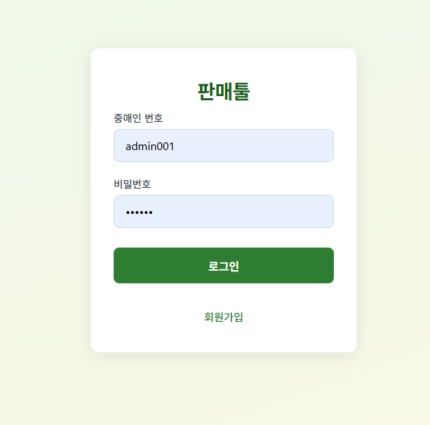
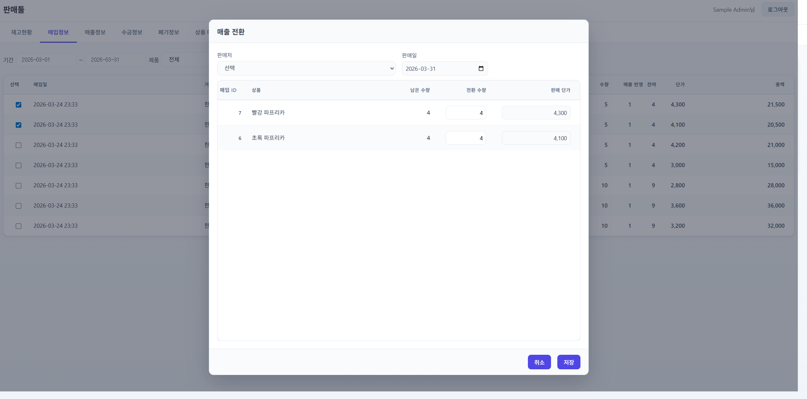
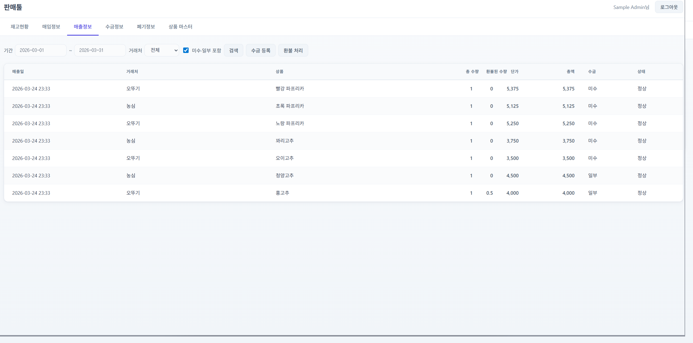
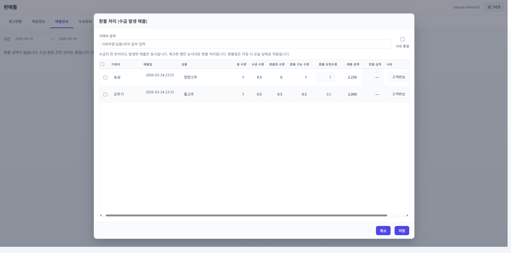
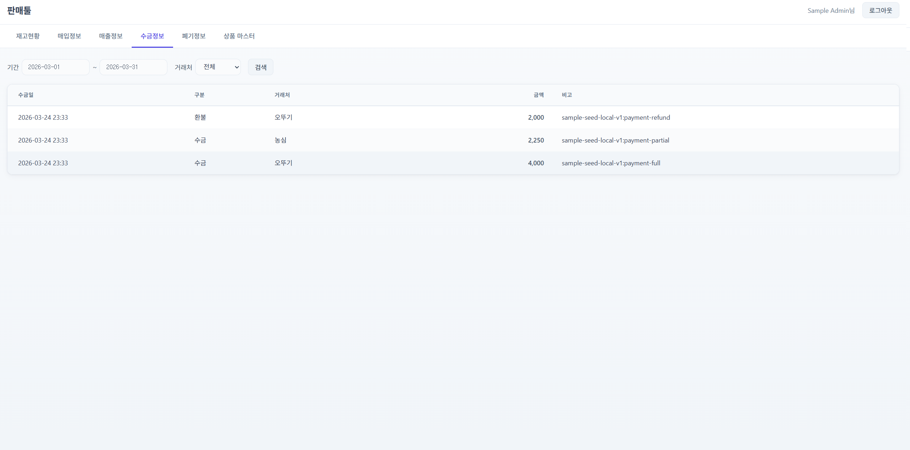

# 판매툴 — 운영자·사용자 매뉴얼

**대상:** 중매인(로그인 사용자). **관리자 전용** 항목은 별도 표기.

> **삽화:** `images/*.svg` 는 자리표시, **`images/*.png` 는 실제 캡처**입니다. PNG를 추가하면 아래 Markdown에서 해당 파일명으로 `` 로 연결하세요.
>
> **최근 대조:** 2026-11-20 소스(`web/src/pages/*.jsx`, `server/index.js`)와 한 줄씩 대조해 문구·열 이름·동작을 맞췄습니다.

---

## 1. 회원가입·로그인·메인 레이아웃

### 1.1 회원가입

📷 **캡처 권장:** 회원가입 화면 전체(이메일 중복확인/인증번호 입력 포함).

<!--  -->

| 항목 | 설명 |
|------|------|
| **상호명, 이메일, 중매인 번호, 비밀번호** | 필수 입력 (휴대폰번호는 받지 않음 — 2026-11-20) |
| **이메일 중복확인** | 형식 검사 후 사용 가능 여부 확인(대소문자 구분 없음). 이메일을 고치면 중복확인·인증을 다시 해야 함 |
| **인증번호 발송** | 중복확인 통과 후 보임. 이메일로 6자리 인증번호 발송(유효시간 5분, 남은 시간 표시). 다시 누르면 새 번호 발송 |
| **인증하기** | 6자리 코드 검증 후 “이메일 인증 완료” 표시. **5회 틀리면** 그 번호는 무효 — 인증번호를 다시 받아야 함 |
| **중매인 번호 중복확인** | 사용 가능 여부 확인. 번호를 고치면 다시 확인해야 함 |
| **개인정보약관 보기 / 동의** | 약관 펼쳐 보기. 미동의 시 회원가입 불가 |
| **회원가입 버튼 활성 조건** | 네 항목 입력 + 이메일 중복확인 + 이메일 인증 완료 + 중매인 번호 중복확인 + 약관 동의 |

**주의:** 이메일 인증 후 **15분 안에** 회원가입 버튼을 눌러야 합니다(지나면 인증을 다시 하라는 안내가 나옴).
**완료 후:** 로그인 화면으로 이동하며 “회원가입이 완료되었습니다. 로그인해 주세요.” 안내가 표시됩니다.

### 1.2 로그인

| 항목 | 설명 |
|------|------|
| **중매인 번호, 비밀번호** | 둘 다 입력 후 **로그인**. 틀리면 “중매인 번호 또는 비밀번호가 올바르지 않습니다.” |
| 비활성 계정 | “비활성화된 계정입니다.” 안내 후 로그인 불가 |
| **회원가입** 링크 | 회원가입 화면으로 이동 |

로그인 정보는 **브라우저 탭(세션)** 에만 저장됩니다. 탭·브라우저를 닫으면 다시 로그인해야 합니다.

### 1.3 메인 레이아웃

📷 **캡처:** 로그인 후 첫 화면 전체(탭·본문이 보이게).

| 영역 | 설명 |
|------|------|
| 헤더 | 서비스명(판매툴), **상호명 + “님”**, 우측 **로그아웃** — 로그인 정보를 지우고 로그인 화면으로 이동 |
| 탭 | **재고현황 · 일별 매입·매출 · 매입정보 · 매출정보 · 수금정보 · 폐기정보** (첫 화면은 재고현황) |
| 본문 | 선택한 탭의 필터·버튼·테이블·모달 |

**관리자:** 맨 끝에 `상품 마스터` 탭이 추가로 보입니다.

**목록 공통:** 기간 필터의 기본값은 **이번 달 1일 ~ 오늘**이며, 탭을 처음 열 때 한 번 조회하고 그다음은 **검색** 버튼을 눌러야 갱신됩니다. 긴 글자는 칸 위에 마우스를 올리면 전체가 보입니다.

---

## 2. 재고현황 탭

📷 **캡처:** 재고현황 테이블이 보이는 화면.

| 요소 | 역할 |
|------|------|
| (필터 없음) | 전체 재고 목록을 불러옴. **수량이 0인 상품은 표시하지 않음** |
| 테이블 열 | **상품명**, **출처**, **매입 거래처**, **수량**, **단위**, **매입일**(일자). 출처·매입 거래처·매입일은 그 상품의 **가장 최근 매입** 기준 |

**역할:** 창고형 재고 수량을 상품별로 확인합니다. 매입·매출 전환·환불(반품 입고)·폐기 후 갱신된 값이 표시됩니다.

---

## 3. 일별 매입·매출 탭

| 요소 | 역할 |
|------|------|
| **일자** | 조회할 하루(기본: 오늘) |
| **거래처 필터** | 비우면 **전체 거래처**. 고르면 매입은 그 구입처, 매출은 그 판매처 기준 |
| **검색** | 조건으로 다시 집계 |
| **일자 요약** 표 | 매입액·매입 건수·매출액·매출 건수·**차이(매출−매입)** |
| **상품·거래처별 내역** 표 | 상품 × 거래처별로 **구분(매입/매출)**·건수·수량·금액·**미수**(매출 행만: 매출금 − 수금). 맨 아래 합계(매입 / 매출) |

**참고:** 취소된 매출은 집계에서 빠집니다.

---

## 4. 매입정보 탭

📷 **캡처:** 매입정보 필터 + 목록 + 상단 버튼 영역.

### 4.1 필터·버튼·목록

| 요소 | 역할 |
|------|------|
| **기간** (시작~끝) | `YYYY-MM-DD` 형식. 해당 기간의 매입만 조회 |
| **제품** | 드롭다운 — 특정 상품만 보거나 **전체** |
| **검색** | 위 조건으로 목록 다시 불러오기 |
| **매입 등록** | 매입 입력 모달을 엽니다 |
| **선택 매출 전환** | 목록에서 체크한 매입 행을 **판매(매출)** 로 전환하는 모달을 엽니다. 남은 수량이 있는 행만 전환됨 |
| 목록 열 | 선택 · 매입일(일시) · 출처 · 매입 거래처 · 상품 · 수량 · **매출 반영** · **잔여** · 단가 · 총액. 잔여가 0인 행은 체크할 수 없음 |

### 4.2 매입 등록 모달

📷 **캡처:** 매입 등록 모달 전체.

| 요소 | 역할 |
|------|------|
| **＋ 행 추가** | 입력 행을 한 줄 늘림 |
| **복제** | 체크한 행 내용을 복사해 새 행 추가 |
| **체크박스** | 행 선택(복제에 사용). 머리글 체크박스는 전체 선택 |
| **출처** | 선택 입력(예: 한국청과) |
| **매입 거래처·상품·수량·단가·매입일** | 필수. 매입 거래처는 공급·도매 등 **매입 가능한 거래처**만 목록에 나옴. 단가는 천 단위 콤마로 표시 |
| **×** | 그 행 삭제(행이 하나뿐이면 삭제 불가) |
| **취소** | 모달 닫기(저장 안 함). 입력하던 행은 남아 있어 다시 열면 이어서 입력 가능 |
| **저장** | 다 채운 행만 서버에 순서대로 등록(빈 행은 무시, 일부만 채운 행이 있으면 저장 안 하고 안내) |

**저장 중 오류:** 오류 메시지는 모달 안에 표시됩니다. 여러 행 중 일부가 이미 저장된 뒤 실패하면, **저장된 행은 입력표에서 빠지고** 남은 행만 남습니다(다시 저장해도 중복 등록되지 않음).

### 4.3 선택 매출 전환 모달

📷 **캡처:** 매출 전환 모달.

| 요소 | 역할 |
|------|------|
| **판매처** | 매출에 찍힐 거래처(판매 가능한 거래처만) |
| **판매일** | 판매 일자(기본: 오늘) |
| 표 | 매입 ID · 상품 · **남은 수량** · **전환 수량** · **판매 단가** |
| **전환 수량·판매 단가** | 기본값은 남은 수량·매입 단가. 매입 잔량 이내로 매출 생성 |
| **저장** | 선택 매입 → 매출 전환 처리(모든 행을 한 번에 처리 — 한 행이라도 실패하면 전부 취소). 오류는 모달 안에 표시 |

---

## 5. 매출정보 탭

📷 **캡처:** 매출정보 필터 + 목록 + `수금 등록` `환불 처리` 버튼.

### 5.1 필터·버튼·목록

| 요소 | 역할 |
|------|------|
| **기간** | 매출일 기준 조회 구간 |
| **거래처** | 특정 거래처만 또는 **전체** |
| **미수·일부 포함** | 체크 시 미수·일부 수금 매출도 목록에 포함. **해제(기본) 시 수금 완료 매출만** 표시 |
| **검색** | 조건으로 목록 갱신 |
| **수금 등록** | 미수 매출에 대해 **한 번에 받은 돈**을 여러 매출에 배분하는 모달 |
| **환불 처리** | 수금이 **한 번이라도 발생한** 매출 중 환불 가능 수량이 남은 건만 모달에 표시 |
| 목록 열 | 매출일 · 거래처 · 상품 · 총 수량 · 환불된 수량 · 단가 · 총액 · **수금**(완료/일부/미수) · **상태**(정상/전액환불/취소) |

### 5.2 수금 등록 모달

📷 **캡처:** 수금 등록 모달(테이블 포함).

| 요소 | 역할 |
|------|------|
| **거래처** | 수금할 거래처 선택(필수). 해당 거래처 **미수 매출**(기간과 무관, 환불·취소 제외)만 표시. 매출정보 탭에서 거래처를 골라 두었으면 미리 선택됨 |
| **수금일시** | `YYYY-MM-DD HH:mm` (기본: 지금) |
| 배분 합계 안내 | 체크한 행의 이번 수금 합계 |
| **행 체크** | 이번 수금에 넣을 매출만 선택(열 때 전부 체크된 상태) |
| **매출일** | 일시 전체가 보이도록 표시(가로 스크롤 없음) |
| **판매처·납품/위치·상품·총 수량·총액·기수금·미수** | 참고 |
| **현재 수금금액** | **숫자만**, **최대 9자리**, **그 행의 미수 금액까지만** 입력됨. 체크한 행에만 입력 |
| **저장** | 수금 건 생성 + 선택 매출에 배분. 서버도 미수를 넘는 배분·환불/취소된 매출 배분을 거절함 |

### 5.3 환불 처리 모달

📷 **캡처:** 환불 처리 모달(검색창·테이블).

| 요소 | 역할 |
|------|------|
| **거래처 검색** | 거래처명·납품/위치 **부분 검색**(대소문자 무관) |
| **사유 통일** | 체크 시 한 행에서 바꾼 사유가 **현재 필터된 모든 행**에 동일 적용 |
| 안내 문구 | 수금 발생 매출만 표시, 체크한 행만 처리, 환불일은 저장 시 당일 |
| **행 체크** | 실제로 환불 API를 호출할 매출 |
| 표 열 | 거래처 · 매출일 · 상품 · 총 수량 · **수금 수량** · 환불된 수량 · **환불 가능 수량** · 환불 요청수량 · **매출 금액**(수금액) · **반품 금액** · 사유 |
| **환불 요청수량** | 체크한 행만 입력(기본: 환불 가능 수량 전체 — 그대로 저장 가능). **0보다 크고 환불 가능 수량 이하**, 소수 **셋째 자리까지**(예: `10`, `0.5`, `2.125`). 2026-11-20 수정 — 예전 "문자열 최소 3자리" 규칙은 기본값(`10`)을 거절했음 |
| **반품 금액** | 자동 계산 = (환불 요청수량 ÷ **환불 가능 수량**) × 매출 금액(현재 수금액). 부분 환불을 여러 번 해도 단가 × 수량만큼 돌아가고, 남은 수량을 전부 환불하면 남은 수금액 전부가 돌아감(2026-11-20 수정 — 예전에는 분모가 총 수량이라 두 번째 환불부터 적게 계산됨). 이 금액이 수금정보에 **환불** 건으로 기록되고 매출의 수금액에서 빠짐 |
| **사유** | 고객변심 / 품질 문제 / 직접 기입. **체크와 관계없이** 언제든 선택·직접 입력 가능 |
| **저장** | 체크한 행만 순서대로 환불 처리. 전량 환불되면 매출 상태가 **전액환불**이 됨 |

**저장 중 오류:** 일부 매출이 이미 환불된 뒤 실패하면, 처리된 건수를 알려 주고 **목록을 새로 불러와 선택을 비웁니다**(같은 환불이 두 번 나가지 않음). 남은 건을 다시 선택해 저장하세요.

---

## 6. 수금정보 탭

📷 **캡처:** 수금정보 목록.

| 요소 | 역할 |
|------|------|
| **기간** | 수금일 기준 |
| **거래처** | 필터 |
| **검색** | 목록 갱신 |
| **수금일** | 일시(`YYYY-MM-DD HH:mm`) |
| **구분** | **수금** / **환불** |
| **거래처·금액·비고** | 건별 내역 확인(환불 건 비고: `환불 #번호 사유`) |

**역할:** 이미 처리된 수금·환불 이력을 조회합니다.

---

## 7. 폐기정보 탭

📷 **캡처:** 폐기정보 기간 필터 + 목록 + `폐기 등록`.

### 7.1 목록 화면

| 요소 | 역할 |
|------|------|
| **기간** | 폐기일 기준 조회 |
| **검색** | 목록 갱신 |
| **폐기 등록** | 재고 기반 폐기 모달 열기 |
| 목록 열 | 폐기일 · 상품 · 수량 · 사유 |

### 7.2 폐기 등록 모달

📷 **캡처:** 폐기 등록 모달(검색줄 + 재고 테이블).

| 요소 | 역할 |
|------|------|
| **출처·매입 거래처 검색** | 출처 또는 매입 거래처명 **부분 검색** |
| **매입일 기준 (From/To)** | `YYYY-MM-DD ~ YYYY-MM-DD` 범위 검색. 기본값은 **D-7 ~ 오늘** |
| 안내 | 값이 있는 조건만 함께 적용(AND). 모두 비우면 전체 재고 표시 |
| 테이블 | 상품 · 재고 수량 · 출처 · 매입 거래처 · 매입일(최근 매입 기준) · 폐기 수량 · 폐기일 · 사유 |
| **체크** | 폐기 처리할 상품 선택(머리글 체크박스는 전체 선택) |
| **폐기 수량·폐기일** | **체크한 행만** 입력 가능. 폐기 수량은 재고 이하, 폐기일 기본은 오늘 |
| **사유** | 상품 변질 / 상품 폐기 / 직접 입력(옆 입력칸). **체크 없이도** 미리 선택·입력 가능 |
| **저장** | 체크한 행만 서버에 폐기 등록(재고 차감) |

**저장 중 오류:** 일부 상품이 이미 폐기 등록된 뒤 실패하면, 처리된 건수를 알려 주고 **재고를 새로 불러와 선택을 비웁니다**. 남은 건을 다시 선택해 저장하세요.

**삭제됨:** 예전의 **복제** 버튼, 행별 상품 콤보·행 추가 방식.

---

## 8. 상품 마스터 탭 (관리자만)

📷 **캡처:** 상품 마스터 목록 + 검색 + 상품 등록.

| 요소 | 역할 |
|------|------|
| **대분류·중분류·소분류** | 드롭다운 검색 조건(현재 목록에 있는 값) |
| **이름 검색** | 상품명 부분 검색 |
| **검색** | 조건으로 목록 갱신 |
| **상품 등록** | 다건 등록 모달(행마다 상품명* · 단위 · 대/중/소분류 · 비고) |
| 모달 내 **＋ 행 추가·×·저장** | 상품명이 있는 행만 등록. 단위를 비우면 `kg`, 상품 키(`P00001` 형식)는 자동 부여 |
| 목록 열 | ID · 상품 키 · 상품명 · 단위 · 대/중/소분류 · 비고 · 등록일 |

---

## 9. 모달 공통 버튼

| 버튼 | 역할 |
|------|------|
| **취소** / 모달 바깥 클릭 | 모달 닫기. 다시 열 때 입력이 초기화됨(매입 등록 포함 — 2026-11-20부터 같음). 저장이 실패하면 모달이 닫히지 않으므로 입력은 그대로 남음 |
| **저장** / **처리 중…** | 폼 제출. 서버 검증 실패 시 모달 안에 메시지 표시 |

---

## 10. 문의·변경 이력

- 화면 구성 변경 요약: `docs/10. 포로젝트 분석설계/화면설계/메인-화면-탭-및-모달-변경이력.md`
- 배포 기록: `docs/99. 배포관리/배포/배포일지/`

---

*본 매뉴얼은 앱 버전에 따라 세부 문구가 달라질 수 있습니다. 불일치 시 이 저장소의 `web/src/pages/Main.jsx` 를 기준으로 수정해 주세요.*
